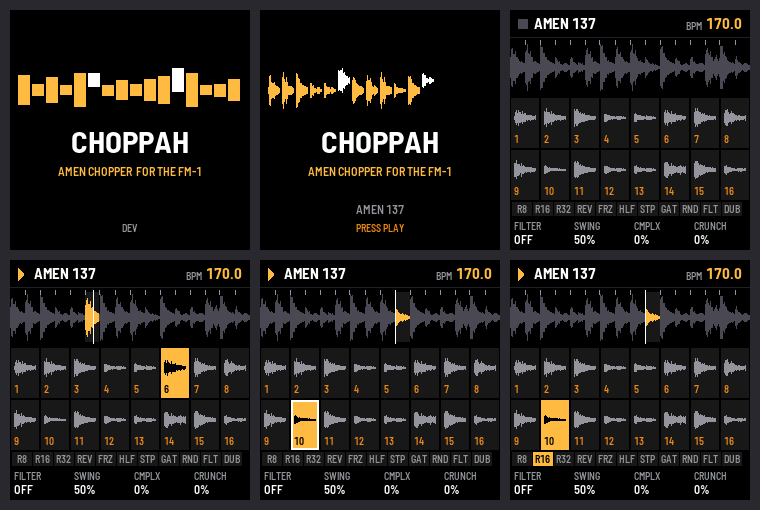
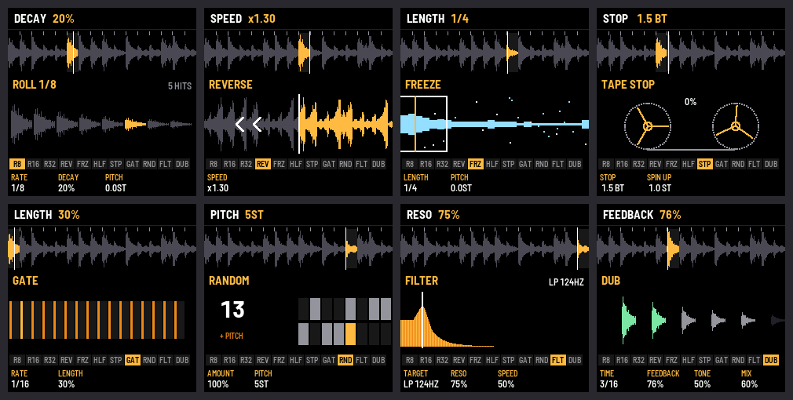

# CHOPPAH: an Amen chopper for the M-VAVE FM-1

CHOPPAH turns the [M-VAVE FM-1](https://www.m-vave.com/) into a breakbeat chopper: a break cut into sixteen slices
on the white keys, momentary effect pads on the black keys, a generator that rearranges the break as it plays, and
ring modulator, hi-pass, flanger, degrader and a DJ filter on the way out. Built on
[fm1-base](https://github.com/charlesvestal/fm1-base) (MPL-2.0).





- **Try it in your browser** (no FM-1 needed): <https://profikid.github.io/fm1-break-choppah/emu/>
- **Install it** (Chrome or Edge, with the FM-1 plugged in): <https://profikid.github.io/fm1-break-choppah/install/>
- **Read the manual**: <https://profikid.github.io/fm1-break-choppah/manual/> (source: [app/docs/MANUAL.md](app/docs/MANUAL.md))
- **Download the firmware**: [releases](https://github.com/profikid/fm1-break-choppah/releases), or from the site

Installing is at your own risk; the installer can put M-VAVE's own firmware back, and an FM-1 that fails to start
twice comes up in a safe mode the installer can still reach. If your FM-1 runs M-VAVE's FM1 Open firmware, restore
M-VAVE's original firmware first ([docs/FLASHING.md](docs/FLASHING.md)).

**Status: early (0.x).** The engine, the slicer, the pads, the generator and the effects work on the device. Saved
patterns, the step sequencer, the looper, MIDI sync and loading your own breaks are next: see the
[PRD](docs/PRD.md) for the whole plan.

## Panel

| Control | Does |
| --- | --- |
| White keys 1–16 | Slices: at the next 16th while playing, at once while stopped. **Hold to loop**: the key's view shows its window and playhead, and **K1–K4 set that key's loop**: length (1/64 … 2 bars), pitch, start, mode (loop, ping-pong, reverse, one shot); SEL resets it |
| Black keys 1–11 | Pads, while held: ROLL 1/8 · 1/16 · 1/32 · REVERSE · FREEZE · HALF · TAPE STOP · GATE · RANDOM · FILTER THROW · DUB DELAY. Each shows its own animation while held, and **K1–K4 tune it** (rate, decay, length, speed, feedback…). The rolls have a LEVEL for quiet ghost-note rolls, and their DECAY fades down or swells up |
| PLAY | Play / stop · HOME + PLAY: back to bar 1 |
| SELECT | Tempo (SEL held: 0.1 BPM) · tap SEL four times: tap tempo |
| OCT− / OCT+ | Pitch in semitones (hold: faster) · both: 0 |
| ALGORITHM | The next break (five synth styles, then 12 recorded Amens) |
| ENV | SOUNDBOARD: the white keys fire 16 sound-system effects over the break: air horn, dub siren, whoop, laser, zap, gunshot, brap, "FYAH!", "HEY!", riser, reverse cymbal, sub drop, horn stab, skank, scratch, rewind (pull-up). K1 level · K2 pitch · K3 echo into the dub delay · K4 length |
| HOME | PERFORM: K1 DJ filter · K2 swing · K3 **gate** (how much of every slice sounds: 100 % off, down to 5 % for tight, clipped chops) · K4 crunch |
| ARP | GENERATOR: complexity · anchor · roll · fill · SEL + ARP: random pattern |
| FX | FX: ALGORITHM picks the effect, K1–K4 its settings, FX again turns it on or off |
| GLO | GLOBAL: K1 MIDI clock in (follow tempo and start / stop), K2 clock out (24 ppqn, start / stop), K3 Bluetooth MIDI on / off (shows up as "CHOPPAH XXXX" in a MIDI app's Bluetooth page), K4 where MIDI goes (USB, Bluetooth, both). **GLO again**: K1 pitch SPEED or KEEP LENGTH (pitch without changing the slices' length), K2 grain size |
| SAVE | Keep the settings |

## Breaks

CHOPPAH has 17 breaks on ALGORITHM: five played by a small drum synth when chosen (Amen, Think, Apache and
Funky-drummer-style grooves and a jungle roller), then 12 recorded Amens, 2 bars each.

The recordings are in [`breaks/`](breaks/): 60 Amen loops by Dmitriy "Cyberworm" Vasilyev, royalty free.
[`breaks/breaks.txt`](breaks/breaks.txt) lists them all and marks with `*` the 12 that go into the firmware (the
firmware has room for about that many). `./build.sh` builds the marked ones into `app/bank_data.h` (generated,
git-ignored) whenever the list or a WAV changes; to use other breaks, move the `*`s, or add WAVs and lines, and
build. `./build.sh bank` builds just the bank and says whether it fits ([breaks/README.md](breaks/README.md)).
Uploading breaks over USB without rebuilding is milestone M5.

## Building

```
scripts/bootstrap.sh    # once: fm1-base (submodule), JieLi toolchain, AC79 SDK files, Python packages
./build.sh test         # the engine's tests, plain cc, no toolchain needed
./build.sh              # app/build/choppah.fwsc (macOS: the toolchain runs in Docker / OrbStack)
./build.sh --host       # the host simulator: app/build/host/choppah_host tests/scenarios/ui.txt OUTDIR
./build.sh --web        # the browser emulator (Emscripten)
./build.sh flash        # install over USB-MIDI (docs/FLASHING.md)
```

Clone with `--recursive` (fm1-base is a submodule in `base/`).

| Path | What |
| --- | --- |
| `app/` | The firmware: `app.c` (screens, controls, glue), `app.h`, `fm1.toml` (build and site settings) |
| `app/dsp/` | The engine, platform-free: `brk` (sequencer, generator, pads, voices), `brk_fx`, `adpcm`, `brk_synth`, `brk_bank.h` |
| `app/docs/`, `app/site/` | The manual and the site's front page |
| `tests/engine/` | Engine tests (plain cc), with WAV renders |
| `tests/scenarios/` | Host-simulator scripts: keys in, audio and screenshots out |
| `breaks/` | The recorded breaks (WAV) and `breaks.txt`, which of them go into the firmware |
| `tools/prep_breaks.py` | WAV → slices → IMA ADPCM bank (`--list breaks/breaks.txt`, as `./build.sh` runs it) |
| `docs/` | [PRD](docs/PRD.md), [flashing and recovery](docs/FLASHING.md) |

## Publishing

Every merge (push) to `main` is a release. GitHub Actions ([.github/workflows/pages.yml](.github/workflows/pages.yml))
takes the last `vX.Y` tag up one minor (`v0.4` → `0.5`), builds the firmware, the emulator and the site with that
version, tags the commit, attaches `choppah-X.Y.fwsc` to a GitHub release with notes from the commits, and publishes
the site to GitHub Pages. No tags or version edits by hand:

- `VERSION` is the floor, not the current release: set it to `1.0` to start 1.x (the next merge releases 1.0, then
  1.1, …). The first release, with no tags yet, is `VERSION` itself. After 0.99 comes 1.0 (two digits each, the
  package identity `FM-1_86XXYYZZ`).
- Re-running a build keeps its commit's version. A manual run (*Run workflow*) of an unreleased commit builds
  `X.Y-dev` and releases nothing.
- `scripts/next_version.sh` prints the version the next merge gets.

`scripts/publish_site.sh VERSION DEST` builds and publishes the same site to any folder or server.

## Licence and credits

MPL-2.0 ([LICENSE](LICENSE)). Built on [fm1-base](https://github.com/charlesvestal/fm1-base) and
[felucca-bsp](https://github.com/hugelton/felucca-bsp), from [Felucca](https://github.com/hugelton/Felucca) by Leo
Kuroshita (Hügelton Instruments). The generator's behaviour follows the ideas of the Amen Break Generator app and BB
Gen; its code is new.

M-VAVE and FM-1 are trademarks of their owners. CHOPPAH is not affiliated with M-VAVE.
