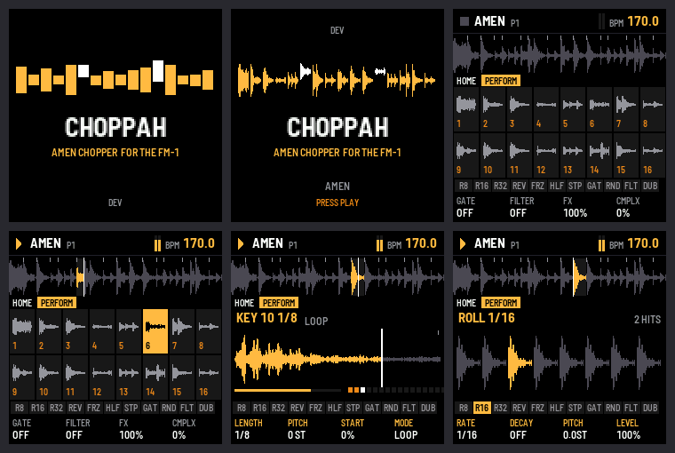
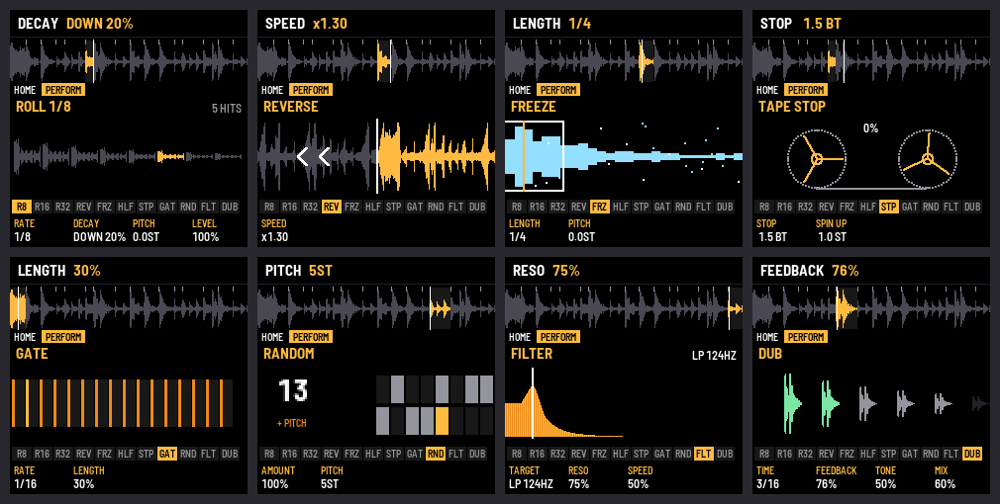

# CHOPPAH: an Amen chopper for the M-VAVE FM-1

CHOPPAH turns the [M-VAVE FM-1](https://www.m-vave.com/) into a breakbeat chopper: a break cut into sixteen slices
on the white keys, momentary effect pads on the black keys, a generator that rearranges the break as it plays, and
a master effects chain (four slots, any of filter, crunch, drive, punch, flanger, ring mod, tremolo, reverb,
ping-pong delay, 3-band EQ, tape saturation, multiband compressor, clipper, in any order), effects per slice, a
16 patterns with a step sequencer and recording, a synthesised four-layer gabber kick, a snare and a hi-hat on the
patterns' drum lanes, MIDI notes for the slices and drums, a DJ filter on the break and a mixer. Built on
[fm1-base](https://github.com/charlesvestal/fm1-base) (MPL-2.0).





- **Try it in your browser** (no FM-1 needed): <https://profikid.github.io/fm1-break-choppah/emu/>
- **Install it** (Chrome or Edge, with the FM-1 plugged in): <https://profikid.github.io/fm1-break-choppah/install/>
- **Read the manual**: <https://profikid.github.io/fm1-break-choppah/manual/> (source: [app/docs/MANUAL.md](app/docs/MANUAL.md))
- **Download the firmware**: [releases](https://github.com/profikid/fm1-break-choppah/releases), or from the site

Installing is at your own risk; the installer can put M-VAVE's own firmware back, and an FM-1 that fails to start
twice comes up in a safe mode the installer can still reach. If your FM-1 runs M-VAVE's FM1 Open firmware, restore
M-VAVE's original firmware first ([docs/FLASHING.md](docs/FLASHING.md)).

**Status: early (0.x).** The engine, the slicer, the pads, the generator, the effects, the patterns and the drums work
on the device. The looper and song mode are next: see the [PRD](docs/PRD.md) for the whole plan.

## Panel

| Control | Does |
| --- | --- |
| White keys 1–16 | Slices: at the next snap point while playing (1 slice by default), at once while stopped. **Hold to loop**: the key's view shows its window and playhead, and **K1–K4 set that key's loop**: length (1/64 … 2 bars), pitch, start, mode (loop, ping-pong, reverse, one shot); SEL resets it. **Key held + FX**: that slice's own effect instead (LO-PASS, HI-PASS, CRUNCH, DRIVE, RING MOD, ECHO / VERB throws, and its LEVEL) |
| Black keys 1–11 | Pads, while held: ROLL 1/8 · 1/16 · 1/32 · REVERSE · FREEZE · HALF · TAPE STOP · GATE · RANDOM · FILTER THROW · DUB (a throw into the delay). Each shows its own animation while held, and **K1–K4 tune it** (rate, decay, length, speed, feedback…). The rolls have a LEVEL for quiet ghost-note rolls, and their DECAY fades down or swells up |
| PLAY | Play / stop · HOME + PLAY: back to bar 1 |
| SELECT | Tempo (SEL held: 0.1 BPM) |
| ENV | **TAP TEMPO**, the whole screen: tap ENV again or any white key in time (from the second tap, the average of the last eight); big digits, the bar's beats; K1 tempo · K2 fine · K3 half / double · K4 the metronome's click level (0: off) |
| SEL (the shift) | **SEL + ALGORITHM** the break and **SEL + PRESETS** the pattern, on every page · **SEL + SAVE** undo the last pattern wipe (again: redo) · **SEL** pressed alone: the strip lists every combination |
| OCT− / OCT+ | Pitch in semitones (hold: faster) · both: 0 |
| ALGORITHM | The next break, its name at once, the break itself at the next bar: AMEN, DRUMMER, THE WORM, THINK, COLD SWEAT, HOT PANTS, APACHE, SPORT |
| PRESETS | The pattern, P1–P16 (playing: from the end of the loop) |
| SEQ | **PATTERN SEQUENCER**: the pattern's 32 break steps (each LOOP, a slice of its own, or off; K1 slice · K2 pitch · K3 hits ×1–×4 · K4 reverse) and its kick, snare and hat lanes (16 steps each: the only place the drums are sequenced). ALGORITHM (or SEQ again) picks the lane, the white keys edit it; on a drum lane K1 FILL (Euclidean hits) · K2 ROTATE · K3 clear / four on the floor · K4 copy the previous pattern's lane |
| REC | Record the white keys and MIDI notes into the pattern as the break plays · SEL + REC: clear (on SEQ the lane, else the pattern) |
| MIDI notes | 48–63 (C3–D#4) play slices 1–16; 36 kick, 38 snare, 42 / 44 / 46 hat; any channel, recorded with REC |
| HOME | PERFORM: K1 **gate** (how much of every slice sounds: 100 % off, down to 5 % for tight, clipped chops) · K2 **DJ filter** on the break alone (left low-pass, right high-pass) · K3 FX · K4 complexity (mirrors of the MIXER's and the GENERATOR's) · **HOME again**: GENERATOR, K1 complexity · K2 anchor · K3 roll · K4 fill |
| LFO | **MIXER**: K1 break level · K2 kick level · K3 snare and hat level · K4 **FX** (the whole effects chain, dry to wet), with meters · **LFO again**: K1 swing · K2 the drums through the chain or around it |
| ARP | **OVERLAY**: sixteen effects on the white keys, over everything, on while held (any together): DIVE, RISE, RADIO, WAH, CRUSH, LO-FI, DIST, RING, CHOP, GATE, DUCK, PAN, BOOM, WOBBLE, JET, CUT; K1 the amount of the one touched last · K2 rate · K3 sweep · K4 latch · SEL + ARP: a random pattern |
| FX | The **master FX chain**: four slots in series. ALGORITHM (or FX again) picks a slot, PRESETS puts an effect in it (FILTER, CRUNCH, DRIVE, PUNCH, FLANGER, RING MOD, TREMOLO, REVERB, DELAY, EQ, TAPE, MB COMP, CLIP, or EMPTY), K1–K3 its settings and K4 its mix, SEL + FX bypasses it, FX held + ALGORITHM moves it along the chain. Every effect shows itself live (its response, a tone through it, its decay or its echoes) with its level in and out, and FX again steps its parts: MORE (extra knobs of its own) and MOD (a tempo-synced or envelope modulator on any of its settings); MB COMP has six parts (amounts, each band's threshold, ratio, attack and release, gains and solo, the splits, knee and output) |
| EDIT | **DRUM DESIGN**: the kick, the snare and the hat (EDIT again: the next drum; the tabs show which). **KICK**: four layers (SUB, PUNCH, GRIT, CLICK) into a clipper; ALGORITHM turns its parts: MIX (the layers' levels) → each layer (level, pitch, decay, tone) and its FX (drive, crunch, filter, ring mod) → MACRO (SUB, PUNCH, GRIT, INTENSITY) → OUT (volume); PRESETS six kicks (909 … ROTTERDAM … DISTORTO). **SNARE / HAT**: tuned body, band-passed noise and crack; six 808-ratio squares and noise; ALGORITHM SOUND (level, tune, decay, tone) / SHAPE (snap or cut, drive), PRESETS four each. Their steps are SEQ's lanes; MIDI 36 / 38 / 42 play them |
| GLO | GLOBAL: K1 MIDI clock in (follow tempo and start / stop), K2 clock out (24 ppqn, start / stop), K3 Bluetooth MIDI on / off (shows up as "CHOPPAH XXXX" in a MIDI app's Bluetooth page), K4 where MIDI goes (USB, Bluetooth, both). **GLO again** (or ALGORITHM): K1 pitch KEEP LENGTH (the default: pitch without changing the slices' length) or SPEED (the classic repitch), K2 grain size, K3 **snap**: where a key pressed while playing lands (OFF, 1/8, 1/4, 1/2, 1, 2, 4 slices), K4 **RESET ALL** (turn twice: every setting and pattern back to the start, pairings kept). **GLO a third time**: **Bluetooth audio out** to headphones or a speaker: K1 on / off, K2 the device, K3 scan (while streaming: a left / right test; K2 then picks joint or plain stereo coding), K4 connect / hang up; stereo (150–300 ms late: for listening) |
| SAVE | Keep the settings and the 16 patterns (a newer version keeps them: new settings start at their defaults) |

## Breaks

CHOPPAH has 8 breaks on ALGORITHM, 2 bars each at 22.05 kHz, from the records: The Winstons "Amen, Brother", James
Brown "Funky Drummer" and "Cold Sweat", Jimmy McGriff "The Worm", Lyn Collins "Think (About It)", Bobby Byrd "Hot
Pants", the Incredible Bongo Band "Apache" and Lightnin' Rod "Sport".

The recordings are in [`breaks/`](breaks/): those ten classic breaks (`classics/`, Rotary Connection and Skull Snaps
too, left out for room) and 60 royalty-free Amen loops by Dmitriy "Cyberworm" Vasilyev (`cw/`, `huge/`).
[`breaks/breaks.txt`](breaks/breaks.txt) lists them all and marks with `*` the 8 that go into the firmware (it has
400 KB for breaks). `./build.sh` builds the marked ones into `app/bank_data.h` (generated,
git-ignored) whenever the list or a WAV changes; to use other breaks, move the `*`s, or add WAVs and lines, and
build. `./build.sh bank` builds just the bank and says whether it fits ([breaks/README.md](breaks/README.md)).
The breaks are built in: CHOPPAH does not load samples of your own.

## Building

```
scripts/bootstrap.sh    # once: fm1-base (submodule), JieLi toolchain, AC79 SDK files, Python packages
./build.sh test         # the engine's tests, plain cc, no toolchain needed
./build.sh              # app/build/choppah.fwsc (macOS: the toolchain runs in Docker / OrbStack)
./build.sh --host       # the host simulator: app/build/host/choppah_host tests/scenarios/ui.txt OUTDIR
./build.sh --web        # the browser emulator (Emscripten)
./build.sh flash        # install over USB-MIDI (docs/FLASHING.md)
```

Clone with `--recursive` (fm1-base is a submodule in `base/`).

| Path | What |
| --- | --- |
| `app/` | The firmware: `app.c` (screens, controls, glue), `app.h`, `fm1.toml` (build and site settings) |
| `app/dsp/` | The engine, platform-free: `brk` (sequencer, generator, pads, voices), `brk_fx`, `adpcm`, `brk_synth`, `brk_bank.h` |
| `app/docs/`, `app/site/` | The manual and the site's front page |
| `tests/engine/` | Engine tests (plain cc), with WAV renders |
| `tests/scenarios/` | Host-simulator scripts: keys in, audio and screenshots out |
| `breaks/` | The recorded breaks (WAV) and `breaks.txt`, which of them go into the firmware |
| `tools/prep_breaks.py` | WAV → slices → IMA ADPCM bank (`--list breaks/breaks.txt`, as `./build.sh` runs it) |
| `docs/` | [PRD](docs/PRD.md), [flashing and recovery](docs/FLASHING.md) |

## Publishing

Every merge (push) to `main` is a release. GitHub Actions ([.github/workflows/pages.yml](.github/workflows/pages.yml))
takes the last `vX.Y` tag up one minor (`v0.4` → `0.5`), builds the firmware, the emulator and the site with that
version, tags the commit, attaches `choppah-X.Y.fwsc` to a GitHub release with notes from the commits, and publishes
the site to GitHub Pages. No tags or version edits by hand:

- `VERSION` is the floor, not the current release: set it to `1.0` to start 1.x (the next merge releases 1.0, then
  1.1, …). The first release, with no tags yet, is `VERSION` itself. After 0.99 comes 1.0 (two digits each, the
  package identity `FM-1_86XXYYZZ`).
- Re-running a build keeps its commit's version. A manual run (*Run workflow*) of an unreleased commit builds
  `X.Y-dev` and releases nothing.
- `scripts/next_version.sh` prints the version the next merge gets.

`scripts/publish_site.sh VERSION DEST` builds and publishes the same site to any folder or server.

## Licence and credits

MPL-2.0 ([LICENSE](LICENSE)). Built on [fm1-base](https://github.com/charlesvestal/fm1-base) and
[felucca-bsp](https://github.com/hugelton/felucca-bsp), from [Felucca](https://github.com/hugelton/Felucca) by Leo
Kuroshita (Hügelton Instruments). The generator's behaviour follows the ideas of the Amen Break Generator app and BB
Gen; its code is new.

M-VAVE and FM-1 are trademarks of their owners. CHOPPAH is not affiliated with M-VAVE.
