# CHOPPAH

CHOPPAH is an Amen chopper for the M-VAVE FM-1. A break is cut into sixteen slices, one on each white key, and
plays in time while you rearrange it, roll it, reverse it, stop it like a tape and push it through effects.

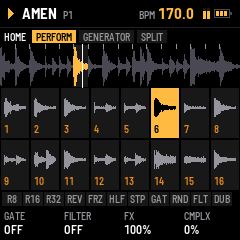

---

## Contents

1. Install
2. The screens (and the screen reader)
3. Playing
4. The pads
5. Patterns and the sequencer
6. The FX chain
7. GLOBAL: MIDI, Bluetooth, pitch, reset (and the MIDI map)
8. MATHCORE: play the break as an instrument (scenes, macros, the Slice Map)
9. The mixer
10. Pages and knobs
11. The control map
12. Saving
13. Troubleshooting

---

## 1. Install

**Try it first:** the emulator runs the same code in the browser, with sound, played with the mouse.

**Install:** open the install page in Chrome or Edge, connect the FM-1 by USB and press Install. While it writes,
the FM-1 says UPDATING and DO NOT UNPLUG: CHOPPAH's slice mark fills in amber with the bar. When it is done, the page
throws confetti. If the FM-1 runs M-VAVE's FM1 Open firmware, put M-VAVE's original firmware back first (M-VAVE's workbench, *Restore original*), then
install CHOPPAH.

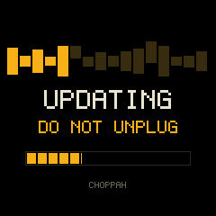

## 2. The screens

At power-on CHOPPAH shows its mark, then the start screen: the loaded break drops in slice by slice while a light
runs through the buttons, they all flash as it completes, and PLAY blinks green. After two
seconds, or at once on any key, the **slicer view** opens. PLAY on the start screen also starts the break.

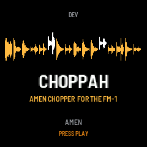

The slicer view, top to bottom:

- **Header:** on the left, play or stop, the break's name (a split: both, "AMEN + THINK", alike; long names
  shorten to their first word), the pattern (P1–P16; "P2>" while P2 waits for the loop's end), REC while
  recording. On the right, from the edge: the battery (three bars, red at one or none; a bolt while a USB host
  powers the FM-1), a level meter (left and right, what leaves after MASTER: amber from −8 dB, white near full
  scale), the tempo (BPM, or EXT while an outside clock leads; BPM's label makes way when the names need the room).
- **Tabs:** the button you pressed (as printed on the panel), then the page's parts as tabs, the one you are on lit:
  the button again (or ALGORITHM) goes to the next. On EDIT and FX the part edited shows at the right, "< SUB FX >".
  Opening a page, or turning to another part, says the same in the header for a moment: the button, then the part
  ("GLO PITCH", "EDIT KICK SUB FX", "FX SLOT 2 TREMOLO", "SEQ HAT"). The tabs sit right under the header on every
  page, tap tempo's too.
- **The break:** its waveform, the slice markers, the slice sounding lit, the playhead.
- **Slice blocks:** sixteen blocks, one per white key, each with its slice's waveform. The slice sounding is lit;
  a key held is outlined; a dot marks a key with a loop of its own (§3, key loops).
- **Pads:** the eleven black-key pads, lit while held.
- **Knobs:** the page's four knobs and their values.

**The rules.** ALGORITHM picks what you edit on the page (an FX slot, a SEQ lane, a MATHCORE lane or scene,
GLOBAL's part); on HOME (both its parts) and the MIXER, where there is nothing to pick, it is the break. PRESETS picks
what goes in (an effect, a lane's knob set); elsewhere it is the pattern. **SEQ is where the pattern is sequenced**
(the break's steps and the kick, snare and hat lanes), **EDIT is MATHCORE** (the Slice Map, scenes that re-cut the break and
the black keys playing scenes); the white keys play slices everywhere but SEQ, MATHCORE's LANE and ENV (tap tempo). **SEL + ALGORITHM is the break and SEL +
PRESETS the pattern on every page.** A page's button pressed again is its next part. **Press SEL** alone and the strip
lists its combinations (SEL again, or any other button, key or knob, closes it). The control map (§11) shows all of it at once.

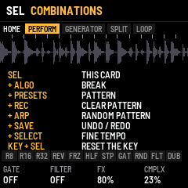

### The demo

Leave CHOPPAH alone for a minute while it is stopped (three minutes while it plays: the break plays on) and it goes
into its demo, five scenes of eight seconds each, in time with the tempo (with the break's own beat while it plays):

- **BARS:** the mark's sixteen bars bouncing to an Amen beat, kick low, snare in the middle, hats high.
- **WAVE:** the break's waveform scrolling under a playhead, a slice chopped out of line on each beat.
- **TUNNEL:** squares rushing out from the name, a white one every second beat.
- **WORMHOLE:** a wireframe tube of twisting rings rushing at you, its far end bending round to a glowing core;
  it lurches forward on each beat.
- **STARS:** slice blocks flying out of the screen.

The lights play along: a light runs round the buttons, and the keys follow the bars, the playhead, the tunnel
(outwards from the middle keys), swirl round with the wormhole or twinkle with the stars. Touch any key, button or knob and the page you left comes
back. That touch only ends the demo: it doesn't play a slice or start the break.

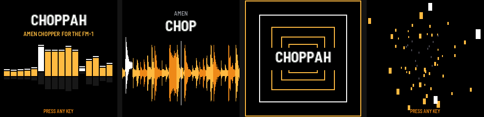

### Screen reader

CHOPPAH can read its screen aloud, for players who can't see it. Connect the FM-1 to a computer by USB, open the
[FM-1 Screen Reader](https://charlesvestal.github.io/fm1-reader/) in Chrome or Edge, and click Connect. The page
speaks with its own voice, or hands the words to your own screen reader (VoiceOver, NVDA, JAWS, TalkBack).

- When the reader connects, and whenever it asks, you hear the whole screen: the page and its part, the four knobs
  with their values, the break, the pattern, the tempo, and whether it is playing.
- A new page or part, a white key held (its loop or its slice effect) or a black-key pad held is said once it
  settles: its name, then its knobs. Letting go of a key or pad says nothing.
- A knob says its name and value when it stops turning. Every message on the screen is said (saved, cleared, next
  pattern, next break), and PLAY says play or stop.
- Warnings are heard whole: an FX slot bypassed for overload, nothing to undo.
- SEL pressed alone reads its combinations.

The words CHOPPAH sends are spelled out in full (CMPLX is complexity, R16 is the 1/16 roll pad, 3/16 is three
sixteenths); the list lives on this site and costs the FM-1 no space. The reader page needs nothing installed.

## 3. Playing

| Control | Does |
| --- | --- |
| PLAY | Play / stop. HOME + PLAY: back to bar 1 |
| White keys | Slices 1–16. Playing: at the next snap point (GLOBAL: 1 slice, an 8th on the 2-bar breaks, by default; OFF, 1/8 … 4 slices). Stopped: at once. Held: the key loops (below), playing or stopped |
| SELECT | Tempo, 1 BPM a detent (0.1 with SEL held) |
| ENV | **Tap tempo**, a page of its own (below) |
| SEL (pressed alone) | The combinations card: every SEL combination on the strip. SEL used with something else (SEL + a knob, SEL + ALGORITHM, SEL + REC…) does that instead |
| SEL + ALGORITHM · SEL + PRESETS | The break · the pattern, from any page |
| SEL + SAVE | **Undo** the last pattern wipe (SEL + ARP, SEL + REC, a drum lane's FILL, CLR / 4X4 or COPY); again: redo |
| OCT− / OCT+ | Pitch in semitones (hold to go faster). Both: back to 0 |
| PRESETS | The pattern, P1–P16 (§5); while playing the new one starts at the end of the loop |
| SEQ · REC | The sequencer; recording the keys into the pattern (§5). SEL + REC: clear the pattern (SEL + SAVE takes it back) |
| MIDI notes | Notes 48–63 (C3–D#4) play slices 1–16, held like the white keys; 64–74 (E4–D5) press black keys 1–11 (on HOME the performance pads, on ARP the effect pads; SEL + the note holds an ARP pad); 24–35 (C1–B1) pick the break; 36 a kick slice, 38 a snare, 42 / 44 / 46 a hat, 37 / 39 a perc one (the Slice Map's, §8). Any channel, or the one set on GLOBAL's CHANNEL part: the whole map is in §7, [MIDI map](#midi-map) |
| ALGORITHM | (HOME, MIXER; SEL held: any page) The next or previous break: its name shows at once (amber in the header) and, while playing, it comes in at the next bar (the old one goes quiet for the bar's last 16th meanwhile); stopped, at once. AMEN (The Winstons), DRUMMER (James Brown, Funky Drummer), THE WORM (Jimmy McGriff), THINK (Lyn Collins), COLD SWEAT (James Brown), HOT PANTS (Bobby Byrd), APACHE (Incredible Bongo Band), SPORT (Lightnin' Rod): 2 bars each (AMEN: the record's bars 3 and 4, the crash in the second), played at the tempo you set. Breaks of your own, when there are some, come first ([Your own breaks](#your-own-break)) |
| MASTER | Volume |

### Your own breaks

Beside the eight built in, the FM-1 holds a **pack** of breaks of your own: up to sixteen.
Make it on the site's [Your breaks](https://profikid.github.io/fm1-break-choppah/breaks/) page, in Chrome or Edge on a
computer:

1. **Load a sample** of your own: a drum loop of whole bars, in any format the browser plays. Or pick one from the
   library (From the library): Cyberworm's sixty royalty-free Amens, each with its tempo and bars, and a search. The page guesses how many bars it is from its length
   (pick another number if it guessed wrong, or type the tempo), and you pick which two bars to use. A tempo under
   95 BPM is doubled when the sample comes in (a two-bar loop at 175 would otherwise be taken for one bar at 87.5);
   ×2 and ÷2 change it.
2. **Hear it chopped**: the page makes the break exactly as the built-in ones were made (levelled to match them, at
   22.05 kHz, sixteen slices snapped to the hits) and plays what the FM-1 will play. Play loops it, a slice or the
   keys 1–8 and Q–I play one slice, Chop rearranges the slices every bar, and the slider previews it at another
   tempo. **Place the slices yourself** if a hit is cut early or late: drag a slice's start on the waveform, and
   place it exactly in the close-up below (60 ms either side), or with ← and → (1 ms; Shift: 10 ms). Each move
   plays the slice. **Warp to the grid** tightens a loose loop: each slice's start becomes a warp marker, pulled
   onto its grid line (every slice an eighth apart), and the sound between is stretched or squeezed to fit, its
   pitch kept and each hit's attack untouched. Place the slices on the hits first, then warp; you go on moving them
   on the original, and hear and send the warped break.
3. **Add it to the pack**, and make the next. **Add these to the pack** in the library adds every break the search
   shows (search "amen0", say, for Cyberworm's numbered ones). The pack lists them in the order the FM-1 will: rename
   one, move it up or down, hear it, take it out.
4. **Connect** the FM-1 by USB, **stop** CHOPPAH, and **send the pack**. A full pack takes about half a minute. The FM-1
   shows it arriving: RECEIVING PACK and the pack's name over a tunnel rushing at you, faster as the bar under the name
   fills (the white keys fill with it), then PACK LOADED, and the slicer with the pack's first. Touching the FM-1
   while it comes only hides the screen (the pack keeps coming; PLAY would stop it); if the send dies, it says PACK
   NOT LOADED after a few seconds.

The flash has **344 KB** for your breaks, in two banks (252 KB and 92 KB; the page lays the pack out over them and
shows how full each is). A two-bar break takes about 5,300 KB ÷ its tempo at the pack's **quality**: at 22.05 kHz,
as the built-in breaks, about ten breaks at 170 BPM; at 16 kHz a third more; at 11.025 kHz (duller) all sixteen.
The quality is for the whole pack; a break under 99.4 BPM is kept at a slightly lower rate still, to fit its two
bars. If the pack doesn't fit, the page says by how much.

On the FM-1 your breaks come **first** (ALGORITHM: yours, then the eight built in), and the pack's first is **the
break CHOPPAH starts with** every time it is switched on. Sending a pack replaces the one there. Connected, the page
lists the FM-1's breaks; **Bring them here** puts them in the pack to hear, reorder, add to and send again, and
**Delete** takes them off (the built-in breaks stay). The pack also stays in the browser until you clear it, and
**Export** saves it as one file (.chpk: the breaks and all the pack's settings) to keep or share; **Import** reads one
back (an older .chb too). Your breaks stay through updates
of CHOPPAH, and RESET ALL keeps them. A CHOPPAH 1.4 or 1.5 takes one break: the page sends the pack's first.

### Packs: a break's own loop, the pack's colours, scenes and overlay (1.7)

A pack made in the **pack builder** (the [Pack builder](https://choppah.app/breaks/) page, also on
[choppah.app](https://choppah.app/), where the [pack hub](https://choppah.app/hub/) keeps and shares packs) carries
more than breaks, and CHOPPAH 1.7 plays all of it:

- **Each break's own loop**: a window of it (2 bars, 1 bar, ½ bar, ¼ bar, from any step) repeated over the two bars,
  so the loop, the generator, MATHCORE and the sequencer play the window; its level, its pitch and swing on top of
  yours, its tempo, and slices marked by hand as kicks, snares, hats or percussion (over the Slice Map's own).
- **Its colours**: the screen in the pack's theme while one of its breaks plays; a built-in break brings amber back.
- **Its MATHCORE scenes**: loading a pack brings its scenes (or CHOPPAH's own when it has none). The scenes and the
  chain you change and SAVE are kept for that pack: another pack never takes them over.
- **An overlay**: a longer loop (4, 8 or 16 bars; a bass line, chords, a vocal: the rest of the track the breaks came
  from) under its breaks, on the bars, with the tempo. It has its own fader on the MIXER (OVERLAY), goes through the
  FX chain or around it (GROOVE's OVL ROUTE), slows with HALF and the TAPE STOP and stops with the transport; nothing
  else of the pads touches it. Under a built-in break it is quiet.

**HOME a fourth time** opens **LOOP**, a pack break's own loop to change on the FM-1:

| Knob | Sets | |
| --- | --- | --- |
| K1 LENGTH | 2 BARS · 1 BAR · 1/2 BAR · 1/4 BAR | The window, repeated over the two bars |
| K2 FROM | STEP 1–32 | Where the window starts |
| K3 PITCH | −24 … +24 | Semitones, on top of the global pitch |
| K4 GAIN | −24 … +12 dB | Its level |

The break follows at the next bar (stopped: at once). **SEL + a knob** brings the pack's own back. SAVE keeps your
changes for that pack; the builder's **Pull the changes from the FM-1** (and its Send, when you send the same pack
again) takes them, and the scenes, back into the pack. Built-in breaks play as they are.

### The split

**HOME a third time** (after PERFORM and the GENERATOR) opens the SPLIT: two breaks in one loop.
Bar 1 is a bar of break A (the break ALGORITHM picks), bar 2 a bar of break B. White keys 1–8 are A's slices, 9–16
B's. B is played at A's tempo: its bar is repitched to the length of A's, as an old sampler would, so the two stay in
time whatever their own tempos. (Until 1.5.1 the split was GLOBAL's third part.)

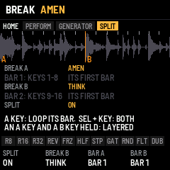

| Knob | Sets | |
| --- | --- | --- |
| K1 SPLIT | OFF · ON | On, the break becomes the two at the next bar (stopped, at once); the header shows both, "AMEN + THINK" |
| K2 BREAK B | Any break | The break in bar 2 (at first, the one after A) |
| K3 BAR A | BAR 1 · BAR 2 | Which of A's two bars plays |
| K4 BAR B | BAR 1 · BAR 2 | Which of B's two bars plays |

Playing a split:

- **A key latches its half.** Press a key of A (1–8) and from the next bar line the loop rounds bar 1 alone; a key of
  B (9–16), bar 2 alone. Switch between them on the fly: the change always waits for the bar line, so it lands in
  time. The loop's own slices (the pattern's, the generator's, RANDOM's) stay in that half.
- **SEL + a key** plays A then B again.
- **ALGORITHM changes the break of the bar looping alone**: with bar 2 latched it turns break B, otherwise break A
  (SEL + ALGORITHM on any page too). The new break comes in at the next bar, as any break change, and the latch
  stays, so you can keep one bar going and swap the break under it.
- **A key of each half held plays both, layered**: the second key loops on voices of its own over the first. One key
  a half: another key in the same half takes that half over, as ever. A key held while one of the other half is held
  doesn't change the latch. The pads (rolls, FREEZE, REVERSE's flip) work on the first key; the layer follows the
  tempo, HALF, REVERSE's speed, the tape stop and its own key's pitch.
- The waveform marks where B begins (amber) and names A and B (the half asked for in amber); the half not playing
  is dark, and a layer's slice is lit beside the key's.

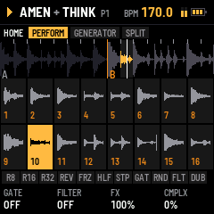

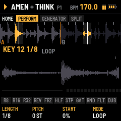

Bar 1 and bar 2 share the one break buffer, so each half is a bar: a split holds two bars, as any break. Bluetooth
audio out (to headphones and speakers) was taken out to make room for it (v1.5).

### Tap tempo

**ENV** opens TAP TEMPO, which takes the whole screen: the tempo on an LED display, a metronome swinging in time (its
bob lights on each beat, white on the bar's first; BEAT counts 1–4 while playing), this run's taps beside the display. Tap **ENV again** in time, or **any white key** (the keys flash on the beat). The tempo follows
from the second tap and settles as you go on (the average of the last eight taps); each tap flashes the display and
sends a ripple out from the metronome.
Stop for 2 seconds to start a new count; a tap far off the pace starts a new count from the tap before it. **K1** sets
the tempo a BPM at a time, **K2** a tenth, **K3** halves it (left) or doubles it (right), **K4** is the
metronome's **CLICK** level, OFF (the start) up to 100 %: a short tick on every beat while playing, higher on the
bar's first, dry over everything (not through the effects), kept with SAVE. Following an outside clock,
it says EXT CLOCK and waits.

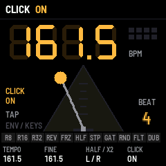

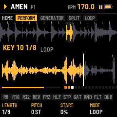

### Key loops

Hold a white key and it loops: a window that starts in its slice plays again and again in time, until you let go
(playing, the break carries on from there; stopped, it ends with the window). Held for a moment, the slice blocks
give way to **the key's view**: its window zoomed to the screen's width, the part this repeat has played lit (from
the right when it runs backwards), the playhead, the slice lines inside the window, this repeat's progress and a dot
for each repeat. A quick tap plays the slice once and keeps the blocks.

While the key is held, **K1–K4 set its loop**, for that key only (SAVE keeps them; a key with a loop of its own has a
dot on its block):

| Knob | Sets | Range |
| --- | --- | --- |
| K1 LENGTH | How long the window is, shown as music for this break | 1/8 of a slice … 16 slices (2-bar breaks: 1/64 … 2 BAR), with the jungle chops between: **3/16** after 1/8 and **3/8** after 1/4 (1.5 and 3 slices) |
| K2 PITCH | The key's own pitch, on top of OCT | −12 … +12 semitones |
| K3 START | Where in the slice the window starts | 0 … 94 % of the slice |
| K4 MODE | LOOP · PING-PONG (every other repeat backwards) · REVERSE · ONE SHOT (once, then quiet while held) | |

SEL while a key is held puts its loop back to one slice, no pitch, from the start, LOOP. With several keys held the
last one pressed loops; let it go and the lowest still held takes over. Pads still work on top: REV turns the loop
round, ROLL and FREEZE take it over while held.

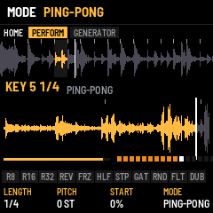

### Slice effects

Every slice can have an effect of its own, there whenever that slice plays: in the loop, from its key, in a roll.
Hold the key and press **FX**: K1–K4 turn from its loop to its slice's effect (FX again turns them back; the knobs
stay on the layer you left them on for the next key). A block whose slice has an effect shows its tag (LP, HP, CR,
DR, RM, EC, VB; LV for a level alone). SEL while held resets the layer shown.

| Knob | Sets |
| --- | --- |
| K1 EFFECT | OFF · LO-PASS · HI-PASS · CRUNCH · DRIVE · RING MOD · ECHO (throws the slice into the FX chain's delay) · VERB (throws it into the reverb) |
| K2 AMOUNT | How much: darker, thinner, crunchier, harder, the ring's pitch, the throw's level |
| K3 TONE | The filters' resonance, RING MOD's mix |
| K4 LEVEL | The slice's own level: accents, or ghost notes of single hits |

ECHO and VERB throw only that slice: put a DELAY (or a REVERB) in the FX chain with its SEND (MIX) low, and only the
slices you marked ring out, the classic dub throw. (Without a DELAY slot, ECHO goes into the delay after the chain.)

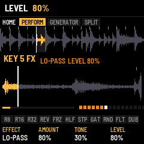

## 4. The pads

The black keys, left to right, act while held and combine. While a pad is held, the slice blocks give way to an
animation of what it does, and **K1–K4 tune that pad** (the foot shows its settings; SAVE keeps them):

| Pad | Does | K1 | K2 | K3 | K4 |
| --- | --- | --- | --- | --- | --- |
| R8 · R16 · R32 | Roll from the next 16th | Rate (1/4 … 1/64, triplets) | Decay: DOWN (each repeat quieter) or UP (a swell up to full) | Pitch a repeat: −12 … +12 semitones in tenths (0.1 a detent, 0.5 when turned quickly), up to three octaves in all | Level of the repeats (5–100 %: low for ghost notes) |
| REV | Reverse | Speed | | | |
| FRZ | Freeze: the slice (or part of it) loops | Length (slice, 1/2, 1/4, 1/8) | Pitch | | |
| HLF | Half speed | Speed | | | |
| STP | Tape stop; let go and it spins back up | Stop time (beats) | Spin-up (16ths) | | |
| GAT | Gate | Rate (1/8, 1/16, 1/32) | Length | | |
| RND | Random slices | Amount | Random pitch | | |
| FLT | Throws the DJ filter | Target (LP … HP) | Resonance | Speed | |
| DUB | Throws the break into the delay (stereo ping-pong); the echoes ring on. With a DELAY in the FX chain it throws into that one, and K1–K4 are that DELAY's | Time (1/8, 3/16, 1/4, 3/8; the DELAY's all eight) | Feedback | Tone | Mix (the DELAY's: Send) |

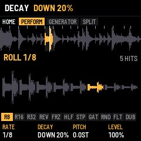
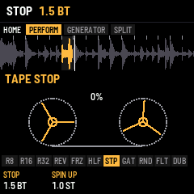 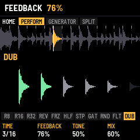

## 5. Patterns and the sequencer

CHOPPAH holds **16 patterns**. Each is the break's 32 steps (2 bars), each step playing the loop's own slice (LOOP,
where the generator can move it), a slice of its own, or nothing; and three drum lanes of 16 steps (kick, snare, hat)
that repeat every bar. A drum lane's hit puts a slice of the break in the loop's place on that step: the first one the
[Slice Map](#mathcore) heard as a kick, a snare or a hat. The break has one voice, so nothing is laid over it: the
hit cuts the loop there (a snare wins over a kick, a kick over a hat on the same step), and the loop goes on after it.
A break without a hat leaves the loop's own slice on the HAT lane's steps. **PRESETS** picks the pattern on most pages; while playing, the next one starts when the loop
comes round (the header shows "P2>").

**SEQ** opens the sequencer. **ALGORITHM** (or **SEQ again**) picks what the white keys edit:

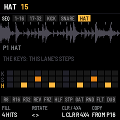

| Lane | White keys | K1 | K2 | K3 | K4 |
| --- | --- | --- | --- | --- | --- |
| STEPS 1-16, STEPS 17-32 | Pick a step to edit (outlined) | SLICE: OFF · LOOP · 1–16 | PITCH: −12 … +12 | HITS: ×1–×4 (a ratchet in the step) | REVERSE |
| KICK, SNARE, HAT | That lane's 16 steps, on and off | FILL: 0–16 hits spread evenly from the downbeat (Euclidean) | ROTATE: the lane a step later (right) or earlier | Left CLEAR, right four on the floor | COPY the previous pattern's lane |

The upper strip shows the half's 16 steps (a number: its own slice; a dot: LOOP; a dash: off; a mark under it: hits
or reverse), the step playing lit; the lower strip all three drum lanes.

**REC** records: while it is lit and the break plays, every white key you press (on HOME and the other pages where
the keys play slices) is written into the pattern at the step it lands on, and so are MIDI notes: 48–63 as slices,
36 / 38 / 42 into the kick, snare and hat lanes (37 and 39, PERC, play but aren't written). REC again stops. **SEL + REC** clears: on SEQ the lane shown, on any
other page the whole pattern. SEL + ARP (a random pattern) writes into the pattern playing. **SEL + SAVE undoes**
either (and FILL, CLR / 4X4 and COPY on a drum lane); press it again to redo. SAVE keeps all 16.

### ARP: effects on the black keys

**ARP** turns the eleven black keys into effect pads. The white keys keep playing slices, as on HOME, so one hand
chops while the other throws effects. Each black key holds an effect of the FX library (FILTER, CRUNCH, DRIVE, PUNCH,
FLANGER, RING MOD, TREMOLO, REVERB, DELAY, EQ, TAPE, CLIP; MB COMP stays the chain's), over everything that plays (the
break, the FX chain and its tails) before the limiter. Hold a key and its effect comes in (a 5 ms fade,
no click), let go and it goes; REVERB and DELAY stop taking sound in, so their tails ring out.

**SEL + a black key holds it** (HOLD, an amber line under its pad): it stays on until SEL + the key again, also on
the other pages, so you can play HOME's slices through it. Four effects sound at once: a fifth key takes the voice of
the oldest (a held one let go first; a latched one taken over lets go).

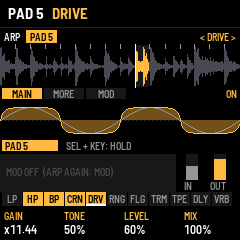

**The key pressed last is the one shown**, in the FX page's own view: its parts (MAIN, MORE, MOD), its picture live,
its modulator and its level in and out. Turn **ALGORITHM** to show another key without playing it. **PRESETS** puts
another effect on it, **K1–K4** set it (as on the FX page, K4 its mix), **ARP again** steps its parts: MORE's extra
knobs and MOD's tempo-synced modulator work as on the FX page (§6). The pads under the strip name each key's effect
(LP, HP, BP for the filters), lit while on.

| Black key | Effect at the start |
| --- | --- |
| 1 · 2 · 3 | FILTER: a resonant low-pass · a high-pass · a band-pass |
| 4 · 5 · 6 | CRUNCH · DRIVE · RING MOD |
| 7 · 8 · 9 | FLANGER · TREMOLO (a 1/16 gate) · TAPE (wow) |
| 10 · 11 | DELAY (a 3/16 throw) · REVERB |

SAVE keeps each key's effect and settings.

They follow the tempo playing (stopped, they keep time by themselves). SAVE keeps the amounts and the knobs.

## 6. The FX chain

**FX** opens the master effects chain: four slots in series, the break (through its DJ filter) into slot 1, then 2,
3 and 4, then on to the DUB
pad's delay and the limiter. Each slot holds any effect (two of one are fine), with
three settings, a mix and a bypass, and more knobs on two more parts (MORE and MOD, below). The screen shows the
effect you tune as a live picture; under it the chain in order (yours lit, the bypassed ones dim), its modulator and
its level in and out.

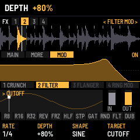

| Control | Does |
| --- | --- |
| ALGORITHM | The slot to tune (1–4) |
| FX again | The slot's next part: MAIN, MORE, MOD (an MB COMP: its six), then the next slot |
| PRESETS | The effect in that slot, through the library (EMPTY first); a new effect comes in on, at its own starting settings |
| K1–K3 · K4 | Its settings · its mix |
| SEL + FX | That slot on / bypassed |
| FX held + ALGORITHM | Moves that slot along the chain (the order is the sound: DRIVE before a FILTER is not a FILTER before DRIVE) |
| MIXER K4 FX | The whole chain against the dry sound: fade every effect in or out at once (the FX page shows it, bottom right) |

| Effect | K1 | K2 | K3 |
| --- | --- | --- | --- |
| FILTER | Cutoff (30 Hz – 16 kHz) | Resonance | Mode: LP · BP · HP |
| CRUNCH | Bits (16 → 2) | Rate (44.1 kHz → 1 kHz) | Drive |
| DRIVE | Gain (×1 – ×30) | Tone (dark → bright) | Level |
| PUNCH | Amount (a drum-bus compressor; low MIX for parallel squash) | Attack (0.1 – 30 ms) | Release (20 – 500 ms) |
| FLANGER | Rate (0.02 – 10 Hz) | Depth | Feedback (−90 … +90 %) |
| RING MOD | Frequency (20 Hz – 2 kHz) | Spread (the right side higher) | |
| TREMOLO | Rate on the tempo (1/2 … 1/32, 1/8T) | Depth | Pan (0 tremolo … 100 % auto-pan) |
| REVERB | Size (short room … long hall) | Tone (bright … dark) | Pre-delay (0 – 60 ms) |
| DELAY | Time on the tempo (1/16, 1/8, 3/16, 1/4, 3/8, 1/2, 1/8T, 1/4T) | Feedback | Tone (dark … bright repeats) |
| EQ | Low (a shelf at 120 Hz) | Mid (a bell; K4 is its frequency, 200 Hz – 5 kHz) | High (a shelf at 8 kHz) |
| TAPE | Drive (0 – 24 dB into a tape curve: denser, warmer, even harmonics; the peaks kept level) | Warmth (the low head bump, the top rolled off) | Wow (and flutter: the pitch wanders like a worn machine) |
| MB COMP | Low amount | Mid amount | High amount (five more parts of its own: below) |
| CLIP | Drive (0 – +24 dB into it) | Knee (soft … hard) | Ceiling (0 – −12 dB) |

**EQ**'s bands go −12 … +12 dB, flat in the middle; its K4 is not a mix but the **mid's frequency**. **TAPE** is a
saturator after a tape machine: put it last in the chain to glue the break, or before CRUNCH for a dusty sampler.

**MB COMP** is a 3-band (multiband) compressor, and the one effect with a page of its own (below). **CLIP** squares
the peaks off at its ceiling: soft rounds them, hard cuts them; below the ceiling it only adds its drive. MB COMP then
CLIP last in the chain is a loud master; CLIP before a FILTER is a fizzy one.

**DELAY** is a stereo ping-pong: the echoes bounce left, right, left, each darker. Its K4 is **SEND**, how much of the
sound reaching it goes in (the echoes come back at full), so with SEND low only throws ring out: the DUB pad, the
the slices' ECHO. There is one delay (0.74 s at most: 1/2 at 162 BPM and up; slower, it holds the
longest it can).

**REVERB** is a plate (after Dattorro's design: diffusers, then a modulated stereo tank): its MIX is how much reverb
goes over the dry sound. The tail rings on after STOP. There is one: a second REVERB slot passes the sound on. Put it
late in the chain to reverb the effects before it, or early to crunch or drive the reverb itself.

The chain starts as CRUNCH → FILTER → FLANGER → RING MOD, all bypassed: SEL + FX switches the focused one on.
CRUNCH used to be HOME's K4; it is slot 1 now.

STOP fades the break out at once (a white key held keeps looping); the reverb's and the dub delay's tails ring on.

### Each effect's view, MORE and MOD

Every effect (but MB COMP, which has its own page, below) has three parts, stepped by **FX again**: **MAIN** (its
three settings and mix, as in the table above), **MORE** (its extra knobs) and **MOD** (a modulator that moves one of
its settings in time). The tab bar names the part (`< FILTER MOD >`), the strip shows it lit.

The picture above follows the sound as you turn:

- **FILTER, FLANGER:** the response from 20 Hz to 20 kHz (the cutoff and resonance; the flanger's comb sweeping as
  it plays). **EQ:** its three bands, ±12 dB about the middle line.
- **DRIVE, CLIP, TAPE, CRUNCH:** a tone through it, the clean tone grey behind: rounded, squared, folded, stepped.
  **PUNCH:** two hits, their peaks held down. **RING MOD:** the tone times its carrier. **TREMOLO:** a tone under two
  of its cycles.
- **REVERB:** its decay over 3 s (0 to −60 dB), the pre-delay a gap. **DELAY:** its echoes, left up and right down,
  each quieter by the feedback.

Below: the chain, then the modulator's cycle with where it is now (the white dot) and what it moves, and the
effect's level in and out.

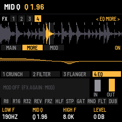

| Effect | MORE K1 | K2 | K3 | K4 |
| --- | --- | --- | --- | --- |
| FILTER | Drive into it | Slope: 12 · 24 dB | Spread (the right's cutoff higher: a stereo filter) | |
| CRUNCH | Tone (a low-pass after it; OFF at full) | Dither (noise under the steps) | | |
| DRIVE | Shape: SOFT · TUBE · HARD · FOLD | Bias (lopsided: even harmonics) | Low cut before it (OFF … 800 Hz) | |
| PUNCH | Ratio (1.5:1 … 20:1) | Make-up (+0 … +12 dB) | SC HPF (the lows don't pump it; OFF … 300 Hz) | |
| FLANGER | Delay (where the sweep starts, 0.2 – 2.7 ms) | Spread (the right's phase, 0 – 180°) | Sync (OFF, or the sweep on the tempo: 4 bars … 1/4) | |
| RING MOD | Wave: SINE · TRI · SQUARE | Mode: RING · AM | | |
| TREMOLO | Shape: SINE · TRI · SQUARE · SAW | Smooth (the edges rounded) | | |
| REVERB | Width | Low cut into it (OFF … 600 Hz) | Mod (the tail's wobble) | Diffusion |
| DELAY | Width (mono … full ping-pong) | Low cut in its loop (each echo thinner) | Duck (the echoes duck under what plays) | |
| EQ | Low shelf's frequency (40 – 400 Hz) | Mid's Q (0.3 – 4) | High shelf's frequency (2 – 16 kHz) | Level (±12 dB) |
| TAPE | Flutter | Wow's rate (0.1 – 3 Hz) | Hiss | |
| CLIP | Bias (lopsided) | Output (−12 … 0 dB) | | |

Every MORE knob starts where the effect always was, so a saved sound plays as it did.

| MOD | K1 | K2 | K3 | K4 |
| --- | --- | --- | --- | --- |
| | Rate on the tempo (4 bars … 1/16, 1/4T, 1/8T) | Depth (OFF in the middle; left moves it the other way) | Shape: SINE · TRIANGLE · SAW · RAMP · SQUARE · S&H · ENV | Target: the effect's K1, K2, K3 or MIX |

**ENV** follows the effect's own input: the louder the break hits, the further it moves (a filter that opens on
every snare, a drive that bites on the kicks). **S&H** jumps to a new random place each cycle. The foot shows the
setting it moves as the modulator leaves it.

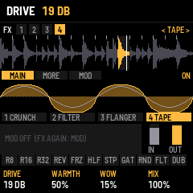

### MB COMP

The break is split into a low, a mid and a high band (by default at 200 Hz and 2.5 kHz), each pressed on its own and
added back together; with nothing pressed the bands add back up to the sound untouched. Focus an MB COMP slot and the
screen turns into the compressor:

- **Above:** its six parts as tabs, then the spectrum from 20 Hz to 20 kHz in the three bands' colours (low red, mid
  amber, high blue). The filled shape is what the sound goes through right now: a band being pressed **dips**, a band
  turned up with GAIN stands above the 0 dB line, and the dotted line shows where it would be with nothing pressed.
  The splits are marked with their frequencies.
- **Below:** each band's curve, input across and output up (−48 … 0 dB): flat at 1:1, bending at the threshold, the
  knee rounding the bend. The white dot is the band's level, riding the curve as the break plays. Beside it, the
  band's level in (the threshold marked white) and its reduction hanging from the top in amber, its peak held for a
  second. On the right, the ratio, the threshold and any gain as they act now; at the top, the reduction in dB.

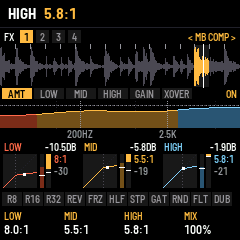

**FX again** steps through the six parts, then on to the next slot; ALGORITHM still jumps straight to another slot
(and an MB COMP there opens on AMOUNT). The tab bar names the part: `< MB COMP LOW >`.

| Part | K1 | K2 | K3 | K4 |
| --- | --- | --- | --- | --- |
| AMOUNT | Low amount | Mid amount | High amount | Mix (parallel: the pressed sound against the dry) |
| LOW · MID · HIGH | Threshold (−48 … 0 dB) | Ratio (1:1 … 20:1, LIMIT) | Attack (0.1 – 100 ms) | Release (10 – 1000 ms) |
| GAIN | Low gain | Mid gain | High gain (each −12 … +12 dB) | Solo: OFF, LOW, MID, HIGH |
| X-OVER | Low split (40 – 800 Hz) | High split (1 – 12 kHz) | Knee (hard … 12 dB soft) | Output (−12 … +12 dB) |

The **amounts** are the knobs to ride while playing: each takes its band from untouched (OFF) to its own threshold and
ratio, and the foot shows the ratio it reaches. The band parts set where full amount lands: by default −30 dB and
8:1, the low slow (10 ms in, 150 ms out), the mid at 5 / 100 ms, the high fast (2 / 60 ms). Half of a band's
reduction at full scale is made back up by itself; GAIN adds or takes away more after it. **Solo** plays the one band
alone, with no dry sound under it, to hear exactly what it holds while you move the splits. The page outlines the band
whose part you are on.

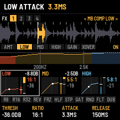

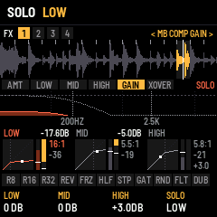

## 7. GLOBAL: MIDI, Bluetooth, pitch, reset

**GLO** opens the GLOBAL page: the slice blocks give way to the state of MIDI, and K1–K4 set it (SAVE keeps it).
**GLO again** (or ALGORITHM) turns to its second part, the pitch; **a third time**, CHANNEL: the MIDI channel and what goes out (all below, with the whole [MIDI map](#midi-map)).

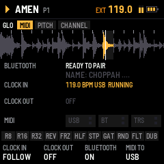

| Knob | Sets | |
| --- | --- | --- |
| K1 CLOCK IN | OFF · FOLLOW | Following, MIDI clock from USB, the TRS jack or Bluetooth sets the tempo (the header says EXT; SELECT and tap tempo wait), START plays from bar 1, CONTINUE from the song position the clock last sent (SONG POSITION), STOP stops, and the loop eases onto the clock's beat every beat |
| K2 CLOCK OUT | OFF · ON | While playing, 24 clocks a beat (straight, whatever the swing); PLAY sends START, stopping sends STOP, HOME + PLAY sends START again |
| K3 BLUETOOTH | ON · OFF | Bluetooth MIDI: the FM-1 shows up as **CHOPPAH XXXX** in a computer's, phone's or tablet's Bluetooth MIDI settings. Off ends the link and stops advertising; at power-on it starts as saved |
| K4 MIDI TO | USB+BT · USB · BT | Where MIDI goes out: the clock, and the notes, CC and program changes CHANNEL sends |

The panel shows Bluetooth's state (ready to pair, connected), the clock coming in (its tempo, where from, running or
stopped), the clock going out, and a light for MIDI in and out on each port. The FM-1 has no MIDI out jack: MIDI goes
out over USB and Bluetooth only. On an iPhone or iPad, Bluetooth MIDI devices never show in Settings → Bluetooth:
connect from a MIDI app's Bluetooth MIDI page (GarageBand: a song's Settings → Advanced → Bluetooth MIDI Devices).

**Pitch and snap (GLO twice):**

| Knob | Sets | |
| --- | --- | --- |
| K1 PITCH | KEEP LENGTH (the default) · SPEED | KEEP LENGTH changes the pitch only: each slice keeps its length (a granular pitch shift), so a key pitched +7 still fills its loop. SPEED is the classic repitch: up plays faster and shorter, down slower and longer (K1 left) |
| K2 GRAIN | 10 … 80 ms | KEEP LENGTH's grains: shorter keeps hits tight, longer sounds smoother on held sounds |
| K3 SNAP | OFF · 1/8 · 1/4 · 1/2 · 1 (the default) · 2 · 4 slices | Where a white key pressed while playing lands: at once (OFF), or at the next point of a grid that many slices apart, counted from the top of the pattern. The panel says what it is in this break (on the 2-bar breaks 1 slice = 1/8, 1/2 slice = 1/16, 2 slices = 1/4). Stopped, keys always play at once |
| K4 RESET ALL | Turn once ("RESET ALL?"), then again within 3 seconds | Clears everything back to how it came: tempo, generator, FX chain, mixer, keys, slices, GLOBAL, the split, all 16 patterns and MATHCORE's scenes and chain; the first break is chosen and it is saved at once. Bluetooth pairings are kept. The screen says so: LOBOTOMIZED, for 3 seconds (a key or button ends it sooner) |

It covers every pitch in semitones: OCT, a key's pitch, the roll's pitch a repeat, the freeze's pitch, steps. The
tempo's own repitch, HALF, REVERSE's speed and the tape stop stay speed effects.

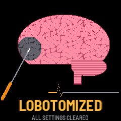

**CHANNEL (GLO three times):** the MIDI channel, and what CHANNEL sends besides the clock. Everything starts off, so
nothing new goes out until you turn it on.

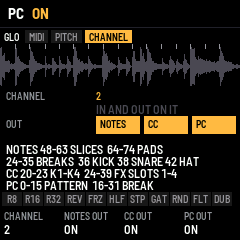

| Knob | Sets | |
| --- | --- | --- |
| K1 CHANNEL | OMNI (the default) · 1 … 16 | OMNI listens to every channel and sends on channel 1. A channel listens to that one only (notes, CC and program changes; the clock has no channel) and sends on it |
| K2 NOTES OUT | OFF · ON | The panel's keys go out as notes: a white key as its slice's note (48–63; on SEQ and tap tempo, where the white keys edit steps or tap, they don't), a black key as its pad's (64–74), velocity 100 |
| K3 CC OUT | OFF · ON | K1–K4 go out as CC 20–23; a chain slot's knob on the FX page as its own CC (24–39, below) instead |
| K4 PC OUT | OFF · ON | A pattern change goes out as program change 0–15, a break change as 16–31 |

What comes in is never sent back out, so a DAW recording CHOPPAH's notes and knobs can play them back into it, and a
MIDI thru loop doesn't feed itself.

### MIDI map

CHOPPAH's MIDI in and out, on every port: USB, the TRS jack (in only) and Bluetooth. Notes, CC and program changes
come in on any channel (OMNI) or on GLOBAL's CHANNEL; the clock and the transport on any. Note names: middle C (60)
is C4.

**Notes in** (also while stopped):

| Notes | Do |
| --- | --- |
| 24–35 (C1–B1) | Pick break 1–12 (playing: at the next bar, as ALGORITHM does) |
| 36 (C2) | A KICK slice (the first the Slice Map heard) |
| 38, 40 (D2, E2) | A SNARE slice |
| 42, 44, 46 (F#2, G#2, A#2) | A HAT slice |
| 37, 39 (C#2, D#2) | A PERC slice |
| 48–63 (C3–D#4) | Slices 1–16, held like the white keys |
| 64–74 (E4–D5) | Black keys 1–11, held like the panel's: on HOME the performance pads, on ARP the effect pads, SEL + the note holds an ARP pad |

Velocity doesn't change the sound; velocity 0 is a note off. With REC on and playing, slice and drum notes are
written into the pattern (as the keys are); break and pad notes are not.

**CC in and out:**

| CC | Does |
| --- | --- |
| 20–23 | K1–K4 on the page you are on, as if turned: by as much as the value moves (the first value only places the fader). Out: the knob's turns, as a value that moves with them |
| 24–27 | FX chain slot 1: SET 1, SET 2, SET 3 (its K1–K3), MIX (K4), 0–127 over the whole range |
| 28–31 | Slot 2, the same |
| 32–35 | Slot 3 |
| 36–39 | Slot 4 |

An empty slot ignores its CCs. The slot CCs set the effect's main settings (its MAIN part on the FX page), whatever
the slot holds.

**Program changes in and out:**

| Program | Does |
| --- | --- |
| 0–15 | Pattern 1–16 (playing: at the loop's end, as PRESETS does) |
| 16–31 | Break 1–16 (the ones the firmware has) |

**Clock and transport** (with CLOCK IN on FOLLOW): 24 clocks a beat set the tempo; START plays from bar 1, CONTINUE
from the last SONG POSITION (counted from the top of the song, so bar 5 of a DAW's song is the loop's first step
again), STOP stops. Out (CLOCK OUT on): 24 clocks a beat while playing, START with PLAY, STOP when it stops.

## 8. MATHCORE

MATHCORE turns the break into an instrument made of its own hits. CHOPPAH listens to the break and knows which
slices are kicks, snares, hats and the rest (the **Slice Map**). Eleven ready scenes sit on the black keys: grooves,
fills, a riser, a breakdown and a drop, of different lengths, each four **lanes** that pick those slices, often in
different cycles (5 against 7 against 11 against 13). A scene doesn't play over the break: it **re-cuts** it, on the
break's own voice, every hit cutting the one before, as a chopped break does. A groove's hits run on into the break
until the next one; fills, the riser and the drop are dry chops. While a scene plays, the pattern (SEQ) rests: the
scene is the beat. You play them: tap a key and the scene comes in, hold it and it
plays while held, turn four knobs and the rhythm thins out, fills up, goes polyrhythmic, doubles or breaks apart.
Nothing has to be programmed (LANE and SCENE are there if you want to). Every sound is the break's.

**EDIT** opens MATHCORE at the part used last; **EDIT again** goes to the next: LIVE → LANE → SCENE → LIVE.

**Nothing to stop or start between them.** While playing, EDIT brings MATHCORE in on the next bar (LIVE: your groove,
or the chain from its top; LANE and SCENE: the scene you edit), and HOME (or SEQ) brings the break's own loop and the
pattern back on the next bar. FX, the MIXER, ARP, GLOBAL and TAP leave whatever plays playing, so you can work the
effects over a scene. HOME's **GATE** shapes MATHCORE's hits as it does the loop's slices, and the DJ filter, the
pads and the FX chain work on them the same way: it is one break, one voice.

### LIVE: play it

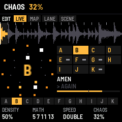

The **wheel** is the scene playing: a ring per lane (the kick inside, then the snare, the perc, the hat outside), its
cycle's steps round it, the hits lit, the step playing white with a short trail. Rings of different lengths turn at
different speeds: that is the polyrhythm, seen. The macros show on it as you turn them: **DENSITY**'s added hits
sparkle white and the hits it leaves out turn to outlines; **MATH** re-divides the rings; **CHAOS** shakes them and
throws sparks; **SPEED** leaves a longer trail and puts x2 or 1/2 under the scene's letter. On the right: the scene
and its name, its phrase so far, what comes next, the four macros' gauges (the one you turn lights up) and the
chain. The **pads row at the bottom** is the black keys: each key's scene letter, the one playing lit, the one coming
next outlined and blinking on the beat, the one held white, a dash under the ones that play once.

| Control | Does |
| --- | --- |
| Black key, tapped | Its scene. Stopped: it plays at once. Playing: a **groove** comes in on the next bar and stays; a **fill, riser or drop** (a dash on its box) comes in on the next beat, plays to its bar line, then your groove is back by itself |
| Black key, held | Momentary: its scene plays while you hold it (a fill rolls on, a groove takes over), and your groove comes back on the next beat after you let go |
| PLAY | Starts the groove (or the chain); again: stop |
| K1 DENSITY | Left: fewer hits (the off-beats go first, the downbeats stay); right: more (the extra hits are the same each cycle, so it still grooves) |
| K2 MATH | From the scenes' own lengths to cycles of 5, 7, 11 and 13 in seven steps: turn it up and straight beats become polyrhythms. The foot shows the lengths |
| K3 SPEED | HALF, NORMAL, DOUBLE: every lane half time or double time |
| K4 CHAOS | Random slices, ratchets and reversals, more as you turn |
| SEL + K1–K4 | The KICK, SNARE, HAT and PERC lanes: left MUTE, right SOLO (a muted lane keeps counting: it comes back in place) |
| White keys | Slices, as on HOME: tap, hold to loop, over everything |
| SEL + black key | Chains its scene (a song of scenes: after each phrase the next, round again) |
| REC + black key | Takes that scene's last entry out of the chain |
| SEL + REC | Clears the chain (the groove plays on) |
| ALGORITHM · PRESETS | The chain's entry pointed at · moved a place later or earlier |

The scenes as they come, on the black keys: **A** ROLLER, **B** AMEN, **C** SNARE ROLLER (a shuffling roller with
triplet hats, a triplet snare roll closing every second bar), **D** SNARES (snares everywhere, round all the break's
snare hits, a triplet roll at every bar's end), **E** MATH 5/7 (5, 7, 11, 13 against the bar, 4 bars); the fills
**F** FILL (two beats of groove, a beat building in triplets, a beat of triplet snares, climbing), **G** TRIPLET ROLL
(a bar of triplet snares swelling up a fourth), **H** SNARE RUSH (8ths, 16ths, 32nds, 64ths: the roll into the
drop), **I** CHOP FILL (3-3-3-3-2-2 cuts, flammed snares); **J** RISER (4 bars) and **K** DROP. On SCENE you can put
the others on a key: **L** STEPPER (half time), **M** DOUBLE, **N** 7/8 BOUNCE, **O** BREAKDOWN, **P** TRIPLET ROLLER
(all in triplets, a roll every second bar). F–K play once; the others loop. The fills keep their climax in their
second half, so one launched late in a bar (it comes in on the next beat, where the bar is) still lands. A roll owns
the break's voice until it's done: hats under it never cut it short. The macros are kept with SAVE.

A scene's name is picked on choppah.app (the MATHCORE editor): besides the factory's sixteen there are polyrhythm
names (HEMIOLA, POLY 3/2 to POLY 7/8, PRIME MATH, PHASE DRIFT, 3/4 IN 4/4 and more) and everyday ones (JUNGLE, TWO
STEP, HALFTIME, BREAKBEAT, STUTTER, BUILD, INTRO, OUTRO and more). A CHOPPAH older than 1.7 shows the new names blank;
the scene plays the same.

### The Slice Map, on HOME

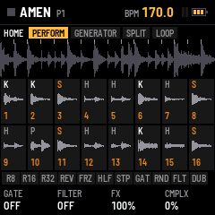

Every time a break loads (a bank break, your own, a split), CHOPPAH listens to the first 60 ms of each slice's hit in
three bands: a low one (a kick's body), a middle one (a snare's body and crack) and a high one (hats and cymbals). A
slice loud in the low band is a **KICK** (K), loud in the middle a **SNARE** (S), a quiet one mostly high a **HAT**
(H), other hits **PERC** (P). Each of KICK, SNARE and HAT gets at least its likeliest slice. There is nothing to set:
the same break always gives the same map. The letters sit at the top of each slice block on HOME (and wherever the
slice blocks show).

### LANE: a lane of a scene

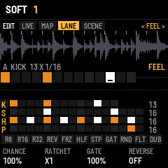

**ALGORITHM** picks the lane (KICK, SNARE, HAT, PERC), **PRESETS** its knob set. The **white keys** turn the lane's
events on and off (SEL + a key: events 17–32); on FEEL they set accents instead. **PLAY** here plays the scene round
and round while you edit it.

| Knobs | K1 | K2 | K3 | K4 |
| --- | --- | --- | --- | --- |
| RHYTHM | LENGTH: 1–32 events in the cycle | RATE: 1/32, 1/16, 1/8, 1/4, 1/32T, 1/16T, 1/8T | ROTATE: the hits a step later (right) or earlier | PHASE: the cycle starts this many events in |
| SOUND | MODE: which of the role's slices (below) | PICK: the slice FIXED, ALT and ACCENT start from | PITCH: −12 … +12 | LEVEL |
| FEEL | CHANCE: each event plays this often (the seed decides, the same every time) | RATCHET: ×1–×4 hits an event | GATE: how much of the slice sounds | VARY: how much the lane varies by itself (below) |
| MORE | ROLE: the slices it plays (KICK, SNARE, HAT, PERC) | RISE: a riser, the lane speeding up over the phrase and climbing this many semitones (OFF: none) | REVERSE | LANE: on or off |

**MODE**: FIXED always the PICKed slice; ROUND each of the role's slices in turn; RANDOM one at random (from the
seed: the same seed, the same choices); ALT two in turn; ACCENT the PICKed slice for soft hits, the next for accents.
A lane with accents plays its other hits at 55 %. A lane whose role has no slice in the break plays nothing and
shows "!" at the end of its row.

**VARY** makes a lane play like a drummer rather than a loop, by itself: on the **hats** every hit at its own
velocity (the off-beat 16ths softer), the break's other hat hits in turn, now and then an off-beat left out or a
little roll, the off-beats laid back a touch; on the **snares** ghost notes round the backbeat (a drag before a hit,
a bounce after, soft and laid back), now and then a flam on an accent and the break's other snare hits; on the
**kick** an occasional pickup before a kick. The last bar of a phrase varies more, as a fill would. A ghost never cuts
a real hit. It all comes from the lane's seed, so a scene plays the same way each time you start it, but no two
bars in a row alike. The scenes come with it set: hats 70 %, snares 60 %, perc 45 %, kick 20 % (fills half that,
risers none).

All lanes count on one clock (the transport's 16ths, twelve ticks each): a 5-event kick lane against a 7-event snare
lane and an 11-event hat lane at 1/32 meet again exactly where they should, bar after bar, and follow MIDI clock.

### SCENE: phrase, break, black key

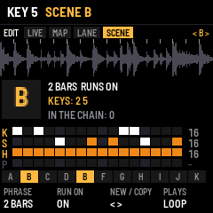

**ALGORITHM** picks the scene (A–P). A **black key** makes that key play this scene (SEL + a black key: that key
plays nothing). The first eleven scenes start on the eleven black keys.

| K1 | K2 | K3 | K4 |
| --- | --- | --- | --- |
| PHRASE: 1, 2, 4 or 8 bars | RUN ON: each hit runs on into the break until the next (YES), or stops with its slice (DRY: dry chops) | NEW / COPY: left, the scene back to how it came; right, a copy of the scene before it | PLAYS: LOOP (a groove) or ONCE (a fill: then back to the groove) |

SAVE keeps the scenes, the chain and the black keys' scenes; they come back after a restart.

## 9. The mixer

**LFO** opens the MIXER: channels side by side, each a fader with a level meter (FX shows the chain's four slots,
lit: on). **LFO again** turns to GROOVE.

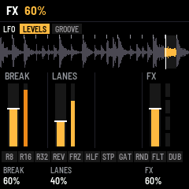

| Half | K1 | K2 | K3 | K4 |
| --- | --- | --- | --- | --- |
| LEVELS | BREAK: the break's level (its throws into the delay and the reverb too; the drum lanes and MATHCORE play the break, so them too) | OVERLAY: the pack's overlay (NONE without one) | | FX: the master FX chain against the dry sound |
| GROOVE | SWING (50–75 %) | OVL ROUTE: the overlay through the FX chain (CHAIN) or around it (AROUND) | | |

FX is how much of the chain you hear. HOME keeps the gate, FX and COMPLEXITY to ride (K1, K3, K4) and the **DJ filter** (K2), which filters the
break (and so the drum lanes and the scenes) as a DJ mixer's filter does. The FLT pad throws it the same way.

## 10. Pages and knobs

| Page | K1 | K2 | K3 | K4 |
| --- | --- | --- | --- | --- |
| HOME (perform) | Gate | DJ filter on the break (left low-pass, right high-pass) | FX (the MIXER's) | Complexity (the GENERATOR's) |
| LFO (mixer) | Break level | Overlay level | | FX (the chain, dry to wet) |
| LFO again (groove) | Swing | Overlay route | | |
| HOME again (generator) | Complexity | Anchor | Roll | Fill |
| HOME a third time (split) | Split on / off | Break B | A's bar | B's bar |
| HOME a fourth time (loop) | Length | From | Pitch | Gain |
| FX (the chain) | the focused slot's effect: its three settings (FX again: its MORE and MOD parts; an MB COMP its six, see §6) | | | Its mix |
| SEQ (patterns) | Slice | Pitch | Hits | Reverse |
| SEQ, a drum lane | Fill | Rotate | Clear / 4x4 | Copy |
| GLO (global) | Clock in | Clock out | Bluetooth | MIDI to |
| GLO again (pitch, snap) | Keep length / speed | Grain | Snap | Reset all (twice) |
| GLO a third time (channel) | MIDI channel (OMNI, 1–16) | Notes out | CC out | Program changes out |
| ARP (black keys hold effects; ARP again: MORE, MOD) | the shown key's effect: setting 1 | Setting 2 | Setting 3 | Mix |
| ENV (tap tempo; ENV again or a white key: a tap) | Tempo | Fine (0.1) | Half / double | Click level (0: off) |
| EDIT (MATHCORE LIVE: the black keys play scenes) | Density | Math (5 / 7 / 11 / 13) | Speed (half / double) | Chaos |
| EDIT again (LANE; PRESETS: RHYTHM, SOUND, FEEL, MORE) | see §8 | | | |
| EDIT a third time (SCENE) | Phrase | Run on | New / copy | Plays: loop / once |

**Gate** (HOME K1) cuts every slice the loop plays short: at 50 % each slice sounds for half its length, then
quiet until the next; down to 5 % for clipped, staccato chops; 100 % is off. It follows the tempo and the pitch, and
the slice lit in the waveform shrinks with it. It covers the loop's slices, ratchets and the RANDOM pad; key loops
(their LENGTH) and rolls keep their own; FREEZE holds the slice whole.

The generator rearranges the break as it plays: **complexity** is how often it jumps, **anchor** keeps the kick and
snare on the beats, **roll** repeats a slice or takes the one next to it, **fill** breaks the rules in the last bar
of a phrase; it is HOME's second part (HOME again). HOME a third time is the [split](#split), a fourth time a pack break's [LOOP](#packs). SEL + ARP writes a random pattern (ARP alone opens the black keys' effects).

## 11. The control map

Every page, button, encoder and key in one place. On the [site's manual](https://profikid.github.io/fm1-break-choppah/manual/#controls)
this section is interactive: pick a page and the screen, the seven encoders and the keys show what they do there;
below it, each button with its parts, the whole map as one table, and which of a held key, a held pad or the page
owns K1–K4. Here, in short: §2 has the rules, §10 every page's knobs.

## 12. Saving

SAVE keeps the tempo, pitch, swing, generator, the FX chain, the break chosen, each key's loop, the mixer, the
GLOBAL settings, all 16 patterns and MATHCORE's 16 scenes, its chain, its macros and the black keys' scenes; SAVE is lit when something changed. A new version keeps what an older
one saved: new settings start at their defaults. (Version 0.32 changed the layout: what 0.31 and older saved starts
over at the defaults once; Bluetooth pairings stay.) GLOBAL's RESET ALL clears it all on purpose (§7).

## 13. Troubleshooting

- **No sound:** turn MASTER up; press PLAY.
- **A crash screen:** press a key to restart. Two failed starts in a row start safe mode, which the installer can
  still reach.
- **The install stops:** press Install again; it finishes a write that was cut off.
