# CHOPPAH

CHOPPAH is an Amen chopper for the M-VAVE FM-1. A break is cut into sixteen slices, one on each white key, and
plays in time while you rearrange it, roll it, reverse it, stop it like a tape and push it through effects.

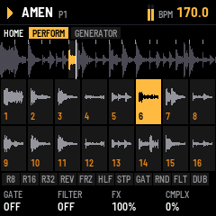

---

## Contents

1. Install
2. The screens
3. Playing
4. The pads
5. Patterns and the sequencer
6. The FX chain
7. GLOBAL: MIDI, Bluetooth, pitch, Bluetooth audio, reset (and the MIDI map)
8. The drums: kick, snare, hat
9. The mixer
10. Pages and knobs
11. The control map
12. Saving
13. Troubleshooting

---

## 1. Install

**Try it first:** the emulator runs the same code in the browser, with sound, played with the mouse.

**Install:** open the install page in Chrome or Edge, connect the FM-1 by USB and press Install. While it writes,
the FM-1 says UPDATING and DO NOT UNPLUG: CHOPPAH's slice mark fills in amber with the bar. When it is done, the page
throws confetti. If the FM-1 runs M-VAVE's FM1 Open firmware, put M-VAVE's original firmware back first (M-VAVE's workbench, *Restore original*), then
install CHOPPAH.

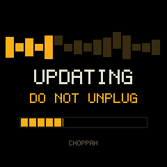

## 2. The screens

At power-on CHOPPAH shows its mark, then the start screen: the loaded break drops in slice by slice while a light
runs through the buttons, they all flash as it completes, and PLAY blinks green. After two
seconds, or at once on any key, the **slicer view** opens. PLAY on the start screen also starts the break.

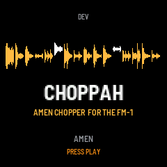

The slicer view, top to bottom:

- **Header:** play or stop, the break's name, the pattern (P1–P16; "P2>" while P2 waits for the loop's end), REC
  while recording, a level meter (left and right, what leaves after MASTER: amber from
  −8 dB, white near full scale), the battery (three bars, red at one or none; a bolt
  while a USB host powers the FM-1), the tempo.
- **Tabs:** the button you pressed (as printed on the panel), then the page's parts as tabs, the one you are on lit:
  the button again (or ALGORITHM) goes to the next. On EDIT and FX the part edited shows at the right, "< SUB FX >".
  Opening a page, or turning to another part, says the same in the header for a moment: the button, then the part
  ("GLO PITCH", "EDIT KICK SUB FX", "FX SLOT 2 TREMOLO", "SEQ HAT"). The tabs sit right under the header on every
  page, tap tempo's too.
- **The break:** its waveform, the slice markers, the slice sounding lit, the playhead.
- **Slice blocks:** sixteen blocks, one per white key, each with its slice's waveform. The slice sounding is lit;
  a key held is outlined; a dot marks a key with a loop of its own (§3, key loops).
- **Pads:** the eleven black-key pads, lit while held.
- **Knobs:** the page's four knobs and their values.

**The rules.** ALGORITHM picks what you edit on the page (an FX slot, a drum's part, a SEQ lane, GLOBAL's part); on HOME (both its parts) and the MIXER, where there is nothing to pick, it is the break. PRESETS picks what goes
in (an effect, a kick, a snare or hat sound); elsewhere it is the pattern. **SEQ is where everything is sequenced**
(the break's steps and the kick, snare and hat lanes), **EDIT where the drums' sounds are made** (kick, snare, hat);
the white keys play slices everywhere but SEQ and ENV (tap tempo). **SEL + ALGORITHM is the break and SEL +
PRESETS the pattern on every page.** A page's button pressed again is its next part. **Press SEL** alone and the strip
lists its combinations (SEL again, or any other button, key or knob, closes it). The control map (§11) shows all of it at once.

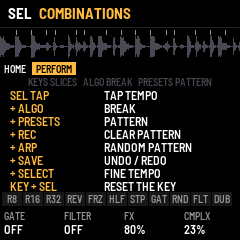

### The demo

Leave CHOPPAH alone for a minute while it is stopped (three minutes while it plays: the break plays on) and it goes
into its demo, five scenes of eight seconds each, in time with the tempo (with the break's own beat while it plays):

- **BARS:** the mark's sixteen bars bouncing to an Amen beat, kick low, snare in the middle, hats high.
- **WAVE:** the break's waveform scrolling under a playhead, a slice chopped out of line on each beat.
- **TUNNEL:** squares rushing out from the name, a white one every second beat.
- **WORMHOLE:** a wireframe tube of twisting rings rushing at you, its far end bending round to a glowing core;
  it lurches forward on each beat.
- **STARS:** slice blocks flying out of the screen.

The lights play along: a light runs round the buttons, and the keys follow the bars, the playhead, the tunnel
(outwards from the middle keys), swirl round with the wormhole or twinkle with the stars. Touch any key, button or knob and the page you left comes
back. That touch only ends the demo: it doesn't play a slice or start the break.

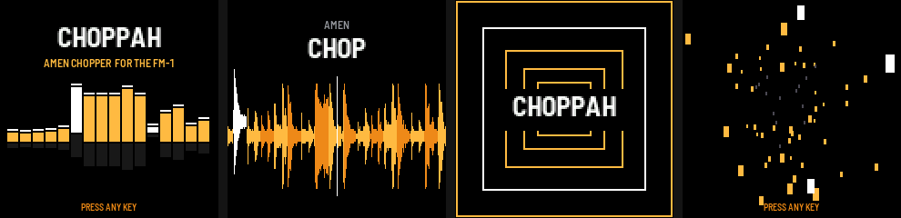

## 3. Playing

| Control | Does |
| --- | --- |
| PLAY | Play / stop. HOME + PLAY: back to bar 1 |
| White keys | Slices 1–16. Playing: at the next snap point (GLOBAL: 1 slice, an 8th on the 2-bar breaks, by default; OFF, 1/8 … 4 slices). Stopped: at once. Held: the key loops (below), playing or stopped |
| SELECT | Tempo, 1 BPM a detent (0.1 with SEL held) |
| ENV | **Tap tempo**, a page of its own (below) |
| SEL (pressed alone) | The combinations card: every SEL combination on the strip. SEL used with something else (SEL + a knob, SEL + ALGORITHM, SEL + REC…) does that instead |
| SEL + ALGORITHM · SEL + PRESETS | The break · the pattern, from any page |
| SEL + SAVE | **Undo** the last pattern wipe (SEL + ARP, SEL + REC, a drum lane's FILL, CLR / 4X4 or COPY); again: redo |
| OCT− / OCT+ | Pitch in semitones (hold to go faster). Both: back to 0 |
| PRESETS | The pattern, P1–P16 (§5); while playing the new one starts at the end of the loop |
| SEQ · REC | The sequencer; recording the keys into the pattern (§5). SEL + REC: clear the pattern (SEL + SAVE takes it back) |
| MIDI notes | Notes 48–63 (C3–D#4) play slices 1–16, held like the white keys; 64–74 (E4–D5) press black keys 1–11 (on HOME the performance pads, on ARP the effect pads; SEL + the note holds an ARP pad); 24–35 (C1–B1) pick the break; 36 the kick, 38 the snare, 42 / 44 / 46 the hat (§8). Any channel, or the one set on GLOBAL's CHANNEL part: the whole map is in §7, [MIDI map](#midi-map) |
| ALGORITHM | (HOME, MIXER; SEL held: any page) The next or previous break: its name shows at once (amber in the header) and, while playing, it comes in at the next bar (the old one goes quiet for the bar's last 16th meanwhile); stopped, at once. AMEN (The Winstons), DRUMMER (James Brown, Funky Drummer), THE WORM (Jimmy McGriff), THINK (Lyn Collins), COLD SWEAT (James Brown), HOT PANTS (Bobby Byrd), APACHE (Incredible Bongo Band), SPORT (Lightnin' Rod): 2 bars each, played at the tempo you set |
| MASTER | Volume |

### Tap tempo

**ENV** opens TAP TEMPO, which takes the whole screen: the tempo on an LED display, a metronome swinging in time (its
bob lights on each beat, white on the bar's first; BEAT counts 1–4 while playing), this run's taps beside the display. Tap **ENV again** in time, or **any white key** (the keys flash on the beat). The tempo follows
from the second tap and settles as you go on (the average of the last eight taps); each tap flashes the display and
sends a ripple out from the metronome.
Stop for 2 seconds to start a new count; a tap far off the pace starts a new count from the tap before it. **K1** sets
the tempo a BPM at a time, **K2** a tenth, **K3** halves it (left) or doubles it (right), **K4** is the
metronome's **CLICK** level, OFF (the start) up to 100 %: a short tick on every beat while playing, higher on the
bar's first, dry over everything (not through the effects), kept with SAVE. Following an outside clock,
it says EXT CLOCK and waits.

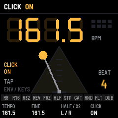

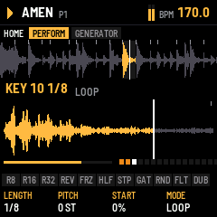

### Key loops

Hold a white key and it loops: a window that starts in its slice plays again and again in time, until you let go
(playing, the break carries on from there; stopped, it ends with the window). Held for a moment, the slice blocks
give way to **the key's view**: its window zoomed to the screen's width, the part this repeat has played lit (from
the right when it runs backwards), the playhead, the slice lines inside the window, this repeat's progress and a dot
for each repeat. A quick tap plays the slice once and keeps the blocks.

While the key is held, **K1–K4 set its loop**, for that key only (SAVE keeps them; a key with a loop of its own has a
dot on its block):

| Knob | Sets | Range |
| --- | --- | --- |
| K1 LENGTH | How long the window is, shown as music for this break | 1/8 of a slice … 16 slices (2-bar breaks: 1/64 … 2 BAR) |
| K2 PITCH | The key's own pitch, on top of OCT | −12 … +12 semitones |
| K3 START | Where in the slice the window starts | 0 … 94 % of the slice |
| K4 MODE | LOOP · PING-PONG (every other repeat backwards) · REVERSE · ONE SHOT (once, then quiet while held) | |

SEL while a key is held puts its loop back to one slice, no pitch, from the start, LOOP. With several keys held the
last one pressed loops; let it go and the lowest still held takes over. Pads still work on top: REV turns the loop
round, ROLL and FREEZE take it over while held.

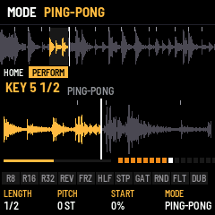

### Slice effects

Every slice can have an effect of its own, there whenever that slice plays: in the loop, from its key, in a roll.
Hold the key and press **FX**: K1–K4 turn from its loop to its slice's effect (FX again turns them back; the knobs
stay on the layer you left them on for the next key). A block whose slice has an effect shows its tag (LP, HP, CR,
DR, RM, EC, VB; LV for a level alone). SEL while held resets the layer shown.

| Knob | Sets |
| --- | --- |
| K1 EFFECT | OFF · LO-PASS · HI-PASS · CRUNCH · DRIVE · RING MOD · ECHO (throws the slice into the FX chain's delay) · VERB (throws it into the reverb) |
| K2 AMOUNT | How much: darker, thinner, crunchier, harder, the ring's pitch, the throw's level |
| K3 TONE | The filters' resonance, RING MOD's mix |
| K4 LEVEL | The slice's own level: accents, or ghost notes of single hits |

ECHO and VERB throw only that slice: put a DELAY (or a REVERB) in the FX chain with its SEND (MIX) low, and only the
slices you marked ring out, the classic dub throw. (Without a DELAY slot, ECHO goes into the delay after the chain.)

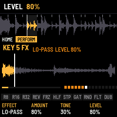

## 4. The pads

The black keys, left to right, act while held and combine. While a pad is held, the slice blocks give way to an
animation of what it does, and **K1–K4 tune that pad** (the foot shows its settings; SAVE keeps them):

| Pad | Does | K1 | K2 | K3 | K4 |
| --- | --- | --- | --- | --- | --- |
| R8 · R16 · R32 | Roll from the next 16th | Rate (1/4 … 1/64, triplets) | Decay: DOWN (each repeat quieter) or UP (a swell up to full) | Pitch a repeat: −12 … +12 semitones in tenths (0.1 a detent, 0.5 when turned quickly), up to three octaves in all | Level of the repeats (5–100 %: low for ghost notes) |
| REV | Reverse | Speed | | | |
| FRZ | Freeze: the slice (or part of it) loops | Length (slice, 1/2, 1/4, 1/8) | Pitch | | |
| HLF | Half speed | Speed | | | |
| STP | Tape stop; let go and it spins back up | Stop time (beats) | Spin-up (16ths) | | |
| GAT | Gate | Rate (1/8, 1/16, 1/32) | Length | | |
| RND | Random slices | Amount | Random pitch | | |
| FLT | Throws the DJ filter | Target (LP … HP) | Resonance | Speed | |
| DUB | Throws the break into the delay (stereo ping-pong); the echoes ring on. With a DELAY in the FX chain it throws into that one, and K1–K4 are that DELAY's | Time (1/8, 3/16, 1/4, 3/8; the DELAY's all eight) | Feedback | Tone | Mix (the DELAY's: Send) |

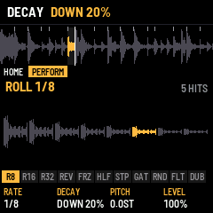
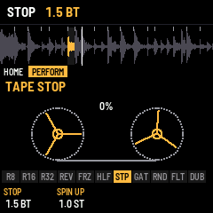 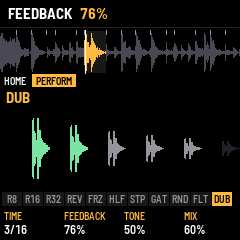

## 5. Patterns and the sequencer

CHOPPAH holds **16 patterns**. Each is the break's 32 steps (2 bars), each step playing the loop's own slice (LOOP,
where the generator can move it), a slice of its own, or nothing; and three drum lanes of 16 steps (kick, snare, hat)
that repeat every bar. **PRESETS** picks the pattern on most pages; while playing, the next one starts when the loop
comes round (the header shows "P2>").

**SEQ** opens the sequencer. **ALGORITHM** (or **SEQ again**) picks what the white keys edit:

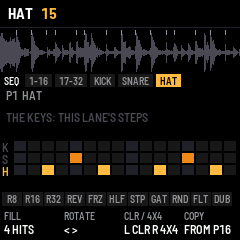

| Lane | White keys | K1 | K2 | K3 | K4 |
| --- | --- | --- | --- | --- | --- |
| STEPS 1-16, STEPS 17-32 | Pick a step to edit (outlined) | SLICE: OFF · LOOP · 1–16 | PITCH: −12 … +12 | HITS: ×1–×4 (a ratchet in the step) | REVERSE |
| KICK, SNARE, HAT | That lane's 16 steps, on and off | FILL: 0–16 hits spread evenly from the downbeat (Euclidean) | ROTATE: the lane a step later (right) or earlier | Left CLEAR, right four on the floor | COPY the previous pattern's lane |

The upper strip shows the half's 16 steps (a number: its own slice; a dot: LOOP; a dash: off; a mark under it: hits
or reverse), the step playing lit; the lower strip all three drum lanes.

**REC** records: while it is lit and the break plays, every white key you press (on HOME and the other pages where
the keys play slices) is written into the pattern at the step it lands on, and so are MIDI notes: 48–63 as slices,
36 / 38 / 42 into the kick, snare and hat lanes. REC again stops. **SEL + REC** clears: on SEQ the lane shown, on any
other page the whole pattern. SEL + ARP (a random pattern) writes into the pattern playing. **SEL + SAVE undoes**
either (and FILL, CLR / 4X4 and COPY on a drum lane); press it again to redo. SAVE keeps all 16.

### ARP: effects on the black keys

**ARP** turns the eleven black keys into effect pads. The white keys keep playing slices, as on HOME, so one hand
chops while the other throws effects. Each black key holds an effect of the FX library (FILTER, CRUNCH, DRIVE, PUNCH,
FLANGER, RING MOD, TREMOLO, REVERB, DELAY, EQ, TAPE, CLIP; MB COMP stays the chain's), over everything that plays (the
break, the drums, the FX chain and its tails) before the limiter. Hold a key and its effect comes in (a 5 ms fade,
no click), let go and it goes; REVERB and DELAY stop taking sound in, so their tails ring out.

**SEL + a black key holds it** (HOLD, an amber line under its pad): it stays on until SEL + the key again, also on
the other pages, so you can play HOME's slices through it. Four effects sound at once: a fifth key takes the voice of
the oldest (a held one let go first; a latched one taken over lets go).

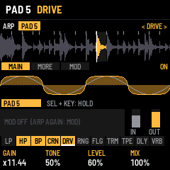

**The key pressed last is the one shown**, in the FX page's own view: its parts (MAIN, MORE, MOD), its picture live,
its modulator and its level in and out. Turn **ALGORITHM** to show another key without playing it. **PRESETS** puts
another effect on it, **K1–K4** set it (as on the FX page, K4 its mix), **ARP again** steps its parts: MORE's extra
knobs and MOD's tempo-synced modulator work as on the FX page (§6). The pads under the strip name each key's effect
(LP, HP, BP for the filters), lit while on.

| Black key | Effect at the start |
| --- | --- |
| 1 · 2 · 3 | FILTER: a resonant low-pass · a high-pass · a band-pass |
| 4 · 5 · 6 | CRUNCH · DRIVE · RING MOD |
| 7 · 8 · 9 | FLANGER · TREMOLO (a 1/16 gate) · TAPE (wow) |
| 10 · 11 | DELAY (a 3/16 throw) · REVERB |

SAVE keeps each key's effect and settings.

They follow the tempo playing (stopped, they keep time by themselves). SAVE keeps the amounts and the knobs.

## 6. The FX chain

**FX** opens the master effects chain: four slots in series, the break (through its DJ filter, with the kick when it
goes through the chain) into slot 1, then 2, 3 and 4, then on to the drums when they go around the chain, the DUB
pad's delay and the limiter. Each slot holds any effect (two of one are fine), with
three settings, a mix and a bypass, and more knobs on two more parts (MORE and MOD, below). The screen shows the
effect you tune as a live picture; under it the chain in order (yours lit, the bypassed ones dim), its modulator and
its level in and out.

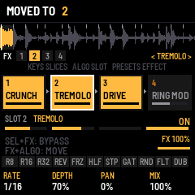

| Control | Does |
| --- | --- |
| ALGORITHM | The slot to tune (1–4) |
| FX again | The slot's next part: MAIN, MORE, MOD (an MB COMP: its six), then the next slot |
| PRESETS | The effect in that slot, through the library (EMPTY first); a new effect comes in on, at its own starting settings |
| K1–K3 · K4 | Its settings · its mix |
| SEL + FX | That slot on / bypassed |
| FX held + ALGORITHM | Moves that slot along the chain (the order is the sound: DRIVE before a FILTER is not a FILTER before DRIVE) |
| MIXER K4 FX | The whole chain against the dry sound: fade every effect in or out at once (the FX page shows it, bottom right) |

| Effect | K1 | K2 | K3 |
| --- | --- | --- | --- |
| FILTER | Cutoff (30 Hz – 16 kHz) | Resonance | Mode: LP · BP · HP |
| CRUNCH | Bits (16 → 2) | Rate (44.1 kHz → 1 kHz) | Drive |
| DRIVE | Gain (×1 – ×30) | Tone (dark → bright) | Level |
| PUNCH | Amount (a drum-bus compressor; low MIX for parallel squash) | Attack (0.1 – 30 ms) | Release (20 – 500 ms) |
| FLANGER | Rate (0.02 – 10 Hz) | Depth | Feedback (−90 … +90 %) |
| RING MOD | Frequency (20 Hz – 2 kHz) | Spread (the right side higher) | |
| TREMOLO | Rate on the tempo (1/2 … 1/32, 1/8T) | Depth | Pan (0 tremolo … 100 % auto-pan) |
| REVERB | Size (short room … long hall) | Tone (bright … dark) | Pre-delay (0 – 60 ms) |
| DELAY | Time on the tempo (1/16, 1/8, 3/16, 1/4, 3/8, 1/2, 1/8T, 1/4T) | Feedback | Tone (dark … bright repeats) |
| EQ | Low (a shelf at 120 Hz) | Mid (a bell; K4 is its frequency, 200 Hz – 5 kHz) | High (a shelf at 8 kHz) |
| TAPE | Drive (0 – 24 dB into a tape curve: denser, warmer, even harmonics; the peaks kept level) | Warmth (the low head bump, the top rolled off) | Wow (and flutter: the pitch wanders like a worn machine) |
| MB COMP | Low amount | Mid amount | High amount (five more parts of its own: below) |
| CLIP | Drive (0 – +24 dB into it) | Knee (soft … hard) | Ceiling (0 – −12 dB) |

**EQ**'s bands go −12 … +12 dB, flat in the middle; its K4 is not a mix but the **mid's frequency**. **TAPE** is a
saturator after a tape machine: put it last in the chain to glue the break, or before CRUNCH for a dusty sampler.

**MB COMP** is a 3-band (multiband) compressor, and the one effect with a page of its own (below). **CLIP** squares
the peaks off at its ceiling: soft rounds them, hard cuts them; below the ceiling it only adds its drive. MB COMP then
CLIP last in the chain is a loud master; CLIP before a FILTER is a fizzy one.

**DELAY** is a stereo ping-pong: the echoes bounce left, right, left, each darker. Its K4 is **SEND**, how much of the
sound reaching it goes in (the echoes come back at full), so with SEND low only throws ring out: the DUB pad, the
the slices' ECHO. There is one delay (0.74 s at most: 1/2 at 162 BPM and up; slower, it holds the
longest it can).

**REVERB** is a plate (after Dattorro's design: diffusers, then a modulated stereo tank): its MIX is how much reverb
goes over the dry sound. The tail rings on after STOP. There is one: a second REVERB slot passes the sound on. Put it
late in the chain to reverb the effects before it, or early to crunch or drive the reverb itself.

The chain starts as CRUNCH → FILTER → FLANGER → RING MOD, all bypassed: SEL + FX switches the focused one on.
CRUNCH used to be HOME's K4; it is slot 1 now.

STOP fades the break out at once (a white key held keeps looping); the reverb's and the dub delay's tails ring on.

### Each effect's view, MORE and MOD

Every effect (but MB COMP, which has its own page, below) has three parts, stepped by **FX again**: **MAIN** (its
three settings and mix, as in the table above), **MORE** (its extra knobs) and **MOD** (a modulator that moves one of
its settings in time). The tab bar names the part (`< FILTER MOD >`), the strip shows it lit.

The picture above follows the sound as you turn:

- **FILTER, FLANGER:** the response from 20 Hz to 20 kHz (the cutoff and resonance; the flanger's comb sweeping as
  it plays). **EQ:** its three bands, ±12 dB about the middle line.
- **DRIVE, CLIP, TAPE, CRUNCH:** a tone through it, the clean tone grey behind: rounded, squared, folded, stepped.
  **PUNCH:** two hits, their peaks held down. **RING MOD:** the tone times its carrier. **TREMOLO:** a tone under two
  of its cycles.
- **REVERB:** its decay over 3 s (0 to −60 dB), the pre-delay a gap. **DELAY:** its echoes, left up and right down,
  each quieter by the feedback.

Below: the chain, then the modulator's cycle with where it is now (the white dot) and what it moves, and the
effect's level in and out.

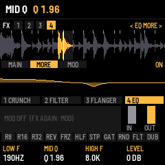

| Effect | MORE K1 | K2 | K3 | K4 |
| --- | --- | --- | --- | --- |
| FILTER | Drive into it | Slope: 12 · 24 dB | Spread (the right's cutoff higher: a stereo filter) | |
| CRUNCH | Tone (a low-pass after it; OFF at full) | Dither (noise under the steps) | | |
| DRIVE | Shape: SOFT · TUBE · HARD · FOLD | Bias (lopsided: even harmonics) | Low cut before it (OFF … 800 Hz) | |
| PUNCH | Ratio (1.5:1 … 20:1) | Make-up (+0 … +12 dB) | SC HPF (the lows don't pump it; OFF … 300 Hz) | |
| FLANGER | Delay (where the sweep starts, 0.2 – 2.7 ms) | Spread (the right's phase, 0 – 180°) | Sync (OFF, or the sweep on the tempo: 4 bars … 1/4) | |
| RING MOD | Wave: SINE · TRI · SQUARE | Mode: RING · AM | | |
| TREMOLO | Shape: SINE · TRI · SQUARE · SAW | Smooth (the edges rounded) | | |
| REVERB | Width | Low cut into it (OFF … 600 Hz) | Mod (the tail's wobble) | Diffusion |
| DELAY | Width (mono … full ping-pong) | Low cut in its loop (each echo thinner) | Duck (the echoes duck under what plays) | |
| EQ | Low shelf's frequency (40 – 400 Hz) | Mid's Q (0.3 – 4) | High shelf's frequency (2 – 16 kHz) | Level (±12 dB) |
| TAPE | Flutter | Wow's rate (0.1 – 3 Hz) | Hiss | |
| CLIP | Bias (lopsided) | Output (−12 … 0 dB) | | |

Every MORE knob starts where the effect always was, so a saved sound plays as it did.

| MOD | K1 | K2 | K3 | K4 |
| --- | --- | --- | --- | --- |
| | Rate on the tempo (4 bars … 1/16, 1/4T, 1/8T) | Depth (OFF in the middle; left moves it the other way) | Shape: SINE · TRIANGLE · SAW · RAMP · SQUARE · S&H · ENV | Target: the effect's K1, K2, K3 or MIX |

**ENV** follows the effect's own input: the louder the break hits, the further it moves (a filter that opens on
every snare, a drive that bites on the kicks). **S&H** jumps to a new random place each cycle. The foot shows the
setting it moves as the modulator leaves it.

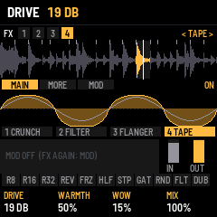

### MB COMP

The break is split into a low, a mid and a high band (by default at 200 Hz and 2.5 kHz), each pressed on its own and
added back together; with nothing pressed the bands add back up to the sound untouched. Focus an MB COMP slot and the
screen turns into the compressor:

- **Above:** its six parts as tabs, then the spectrum from 20 Hz to 20 kHz in the three bands' colours (low red, mid
  amber, high blue). The filled shape is what the sound goes through right now: a band being pressed **dips**, a band
  turned up with GAIN stands above the 0 dB line, and the dotted line shows where it would be with nothing pressed.
  The splits are marked with their frequencies.
- **Below:** each band's curve, input across and output up (−48 … 0 dB): flat at 1:1, bending at the threshold, the
  knee rounding the bend. The white dot is the band's level, riding the curve as the break plays. Beside it, the
  band's level in (the threshold marked white) and its reduction hanging from the top in amber, its peak held for a
  second. On the right, the ratio, the threshold and any gain as they act now; at the top, the reduction in dB.

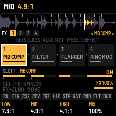

**FX again** steps through the six parts, then on to the next slot; ALGORITHM still jumps straight to another slot
(and an MB COMP there opens on AMOUNT). The tab bar names the part: `< MB COMP LOW >`.

| Part | K1 | K2 | K3 | K4 |
| --- | --- | --- | --- | --- |
| AMOUNT | Low amount | Mid amount | High amount | Mix (parallel: the pressed sound against the dry) |
| LOW · MID · HIGH | Threshold (−48 … 0 dB) | Ratio (1:1 … 20:1, LIMIT) | Attack (0.1 – 100 ms) | Release (10 – 1000 ms) |
| GAIN | Low gain | Mid gain | High gain (each −12 … +12 dB) | Solo: OFF, LOW, MID, HIGH |
| X-OVER | Low split (40 – 800 Hz) | High split (1 – 12 kHz) | Knee (hard … 12 dB soft) | Output (−12 … +12 dB) |

The **amounts** are the knobs to ride while playing: each takes its band from untouched (OFF) to its own threshold and
ratio, and the foot shows the ratio it reaches. The band parts set where full amount lands: by default −30 dB and
8:1, the low slow (10 ms in, 150 ms out), the mid at 5 / 100 ms, the high fast (2 / 60 ms). Half of a band's
reduction at full scale is made back up by itself; GAIN adds or takes away more after it. **Solo** plays the one band
alone, with no dry sound under it, to hear exactly what it holds while you move the splits. The page outlines the band
whose part you are on.

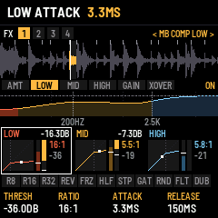

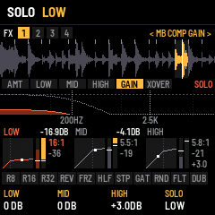

## 7. GLOBAL: MIDI, Bluetooth, pitch, Bluetooth audio, reset

**GLO** opens the GLOBAL page: the slice blocks give way to the state of MIDI, and K1–K4 set it (SAVE keeps it).
**GLO again** (or ALGORITHM) turns to its second part, the pitch; **a third time**, Bluetooth audio; **a fourth
time**, CHANNEL: the MIDI channel and what goes out (all below, with the whole [MIDI map](#midi-map)).

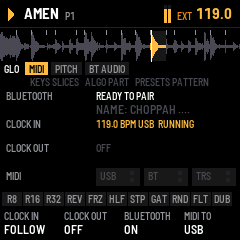

| Knob | Sets | |
| --- | --- | --- |
| K1 CLOCK IN | OFF · FOLLOW | Following, MIDI clock from USB, the TRS jack or Bluetooth sets the tempo (the header says EXT; SELECT and tap tempo wait), START plays from bar 1, CONTINUE from the song position the clock last sent (SONG POSITION), STOP stops, and the loop eases onto the clock's beat every beat |
| K2 CLOCK OUT | OFF · ON | While playing, 24 clocks a beat (straight, whatever the swing); PLAY sends START, stopping sends STOP, HOME + PLAY sends START again |
| K3 BLUETOOTH | ON · OFF | Bluetooth MIDI: the FM-1 shows up as **CHOPPAH XXXX** in a computer's, phone's or tablet's Bluetooth MIDI settings. Off ends the link and stops advertising; at power-on it starts as saved |
| K4 MIDI TO | USB+BT · USB · BT | Where MIDI goes out: the clock, and the notes, CC and program changes CHANNEL sends |

The panel shows Bluetooth's state (ready to pair, connected), the clock coming in (its tempo, where from, running or
stopped), the clock going out, and a light for MIDI in and out on each port. The FM-1 has no MIDI out jack: MIDI goes
out over USB and Bluetooth only. On an iPhone or iPad, Bluetooth MIDI devices never show in Settings → Bluetooth:
connect from a MIDI app's Bluetooth MIDI page (GarageBand: a song's Settings → Advanced → Bluetooth MIDI Devices).

**Pitch and snap (GLO twice):**

| Knob | Sets | |
| --- | --- | --- |
| K1 PITCH | KEEP LENGTH (the default) · SPEED | KEEP LENGTH changes the pitch only: each slice keeps its length (a granular pitch shift), so a key pitched +7 still fills its loop. SPEED is the classic repitch: up plays faster and shorter, down slower and longer (K1 left) |
| K2 GRAIN | 10 … 80 ms | KEEP LENGTH's grains: shorter keeps hits tight, longer sounds smoother on held sounds |
| K3 SNAP | OFF · 1/8 · 1/4 · 1/2 · 1 (the default) · 2 · 4 slices | Where a white key pressed while playing lands: at once (OFF), or at the next point of a grid that many slices apart, counted from the top of the pattern. The panel says what it is in this break (on the 2-bar breaks 1 slice = 1/8, 1/2 slice = 1/16, 2 slices = 1/4). Stopped, keys always play at once |
| K4 RESET ALL | Turn once ("RESET ALL?"), then again within 3 seconds | Clears everything back to how it came: tempo, generator, FX chain, kick, snare and hat, mixer, keys, slices, GLOBAL, Bluetooth audio, and all 16 patterns; the first break is chosen and it is saved at once. Bluetooth pairings are kept. The screen says so: LOBOTOMIZED, for 3 seconds (a key or button ends it sooner) |

It covers every pitch in semitones: OCT, a key's pitch, the roll's pitch a repeat, the freeze's pitch, steps. The
tempo's own repitch, HALF, REVERSE's speed and the tape stop stay speed effects.

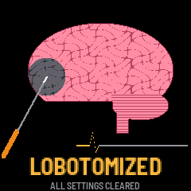

**Bluetooth audio (GLO three times):** CHOPPAH plays through Bluetooth headphones or a Bluetooth speaker.

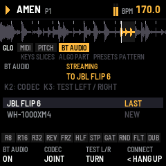

| Knob | Does |
| --- | --- |
| K1 BT AUDIO | OFF · ON. On at power-on as saved (SAVE), and then it connects the last device again by itself |
| K2 DEVICE | Picks from the list: the devices it remembers (LAST, KNOWN), then the ones a scan found (NEW) |
| K3 SCAN | Any turn looks for headphones and speakers for about 10 seconds. Put the device in pairing mode first |
| K4 CONNECT | Right: connect the device chosen (a new one pairs and is remembered; four are kept). Left: hang up. SEL held + left: forget the remembered device chosen |

While it streams, the FM-1's own speaker and headphone output go quiet and MASTER still sets the level. It is stereo,
as the FM-1's own output: the ping-pong delay, the reverb and the flanger spread left and right. Bluetooth
audio runs late: 150–300 ms between a key and your ear, so it is for listening and showing, not for playing in time
(use the FM-1's own output or USB for that). Bluetooth MIDI keeps working beside it on the same radio. Turning
Bluetooth audio on starts the radio even when Bluetooth MIDI is off.

**CHANNEL (GLO four times):** the MIDI channel, and what CHANNEL sends besides the clock. Everything starts off, so
nothing new goes out until you turn it on.

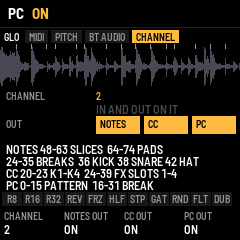

| Knob | Sets | |
| --- | --- | --- |
| K1 CHANNEL | OMNI (the default) · 1 … 16 | OMNI listens to every channel and sends on channel 1. A channel listens to that one only (notes, CC and program changes; the clock has no channel) and sends on it |
| K2 NOTES OUT | OFF · ON | The panel's keys go out as notes: a white key as its slice's note (48–63; on SEQ and tap tempo, where the white keys edit steps or tap, they don't), a black key as its pad's (64–74), velocity 100 |
| K3 CC OUT | OFF · ON | K1–K4 go out as CC 20–23; a chain slot's knob on the FX page as its own CC (24–39, below) instead |
| K4 PC OUT | OFF · ON | A pattern change goes out as program change 0–15, a break change as 16–31 |

What comes in is never sent back out, so a DAW recording CHOPPAH's notes and knobs can play them back into it, and a
MIDI thru loop doesn't feed itself.

### MIDI map

CHOPPAH's MIDI in and out, on every port: USB, the TRS jack (in only) and Bluetooth. Notes, CC and program changes
come in on any channel (OMNI) or on GLOBAL's CHANNEL; the clock and the transport on any. Note names: middle C (60)
is C4.

**Notes in** (also while stopped):

| Notes | Do |
| --- | --- |
| 24–35 (C1–B1) | Pick break 1–12 (playing: at the next bar, as ALGORITHM does) |
| 36 (C2) | The kick |
| 38 (D2) | The snare |
| 42, 44, 46 (F#2, G#2, A#2) | The hat |
| 48–63 (C3–D#4) | Slices 1–16, held like the white keys |
| 64–74 (E4–D5) | Black keys 1–11, held like the panel's: on HOME the performance pads, on ARP the effect pads, SEL + the note holds an ARP pad |

Velocity doesn't change the sound; velocity 0 is a note off. With REC on and playing, slice and drum notes are
written into the pattern (as the keys are); break and pad notes are not.

**CC in and out:**

| CC | Does |
| --- | --- |
| 20–23 | K1–K4 on the page you are on, as if turned: by as much as the value moves (the first value only places the fader). Out: the knob's turns, as a value that moves with them |
| 24–27 | FX chain slot 1: SET 1, SET 2, SET 3 (its K1–K3), MIX (K4), 0–127 over the whole range |
| 28–31 | Slot 2, the same |
| 32–35 | Slot 3 |
| 36–39 | Slot 4 |

An empty slot ignores its CCs. The slot CCs set the effect's main settings (its MAIN part on the FX page), whatever
the slot holds.

**Program changes in and out:**

| Program | Does |
| --- | --- |
| 0–15 | Pattern 1–16 (playing: at the loop's end, as PRESETS does) |
| 16–31 | Break 1–16 (the ones the firmware has) |

**Clock and transport** (with CLOCK IN on FOLLOW): 24 clocks a beat set the tempo; START plays from bar 1, CONTINUE
from the last SONG POSITION (counted from the top of the song, so bar 5 of a DAW's song is the loop's first step
again), STOP stops. Out (CLOCK OUT on): 24 clocks a beat while playing, START with PLAY, STOP when it stops.

## 8. The drums: kick, snare, hat

Three synthesised drums play under the break, in time with it (swing included), on the pattern's drum lanes (§5):
their steps are SEQ's KICK, SNARE and HAT lanes; their sounds are made on **EDIT**. They go through the FX chain or
around it together (MIXER GROOVE K2).

**EDIT** opens the drum edited last; **EDIT again** goes to the next: KICK → SNARE → HAT → KICK (the tabs show which).
**ALGORITHM** turns through the drum's parts, **PRESETS** loads a built-in sound. The lower strip shows the three
drums side by side, each with its waveform (one hit, drawn again as you change the sound), the one edited outlined,
lit on its hits. The white keys keep playing slices.

### The kick

A synthesised kick for gabber, hardcore and techno. ALGORITHM turns through its parts: MIX → SUB → SUB FX → PUNCH →
PUNCH FX → GRIT → GRIT FX → CLICK → CLICK FX → MACRO → OUT (each layer's part is its LAYER knobs, its FX part its
LAYER FX knobs).

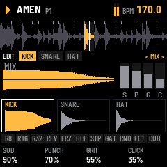

The kick is four layers summed and pushed into a clipper:

| Layer | Is | PITCH | DECAY |
| --- | --- | --- | --- |
| SUB | The low end: a sine dropping onto its pitch (TONE saturates it) | 30 – 90 Hz | 60 – 1500 ms |
| PUNCH | The hit and the body: a sine swept down fast (TONE: how far it sweeps) | 50 – 200 Hz | 20 – 400 ms |
| GRIT | The dirty mids: FM through a drive (TONE: more FM and noise) | 40 – 400 Hz | 20 – 800 ms |
| CLICK | The attack: a click and noise (TONE: from click to noise) | 1 – 12 kHz | 1 – 40 ms |

| Control | Does |
| --- | --- |
| ALGORITHM | The part: MIX, a layer (SUB, PUNCH, GRIT, CLICK), its FX, MACRO, OUT |
| PRESETS | A built-in kick: 909, TECHNO, EARLY HC, ROTTERDAM (the start), INDUSTRIAL, DISTORTO. The steps, routing and volume stay |
| MIDI note 36 (C2) | Plays the kick, on the MIDI channel (§7, [MIDI map](#midi-map)), also while stopped |

| Part | K1 | K2 | K3 | K4 |
| --- | --- | --- | --- | --- |
| MIX | SUB level | PUNCH level | GRIT level | CLICK level |
| SUB · PUNCH · GRIT · CLICK | Level | Pitch | Decay | Tone |
| … FX | Effect: OFF · DRIVE · CRUNCH · FILTER · RING MOD | A (gain · bits · cutoff · frequency) | B (tone · rate · resonance) | Wet |
| MACRO | SUB (level, tail, weight) | PUNCH (level, sweep, click) | GRIT (level, dirt, tail) | INTENSITY |
| OUT | Volume | | | |

**INTENSITY** is the drive into the clipper: low is a clean, round kick; past half the clip turns hard, the tail
flattens into the long, distorted gabber kick. The page is laid out as the snare's and the hat's: the part's four
settings as bars, under them the four layers' levels (the layer edited lit, amber with an effect on); the kick's
shape is its box in the strip below. Its steps: SEQ's KICK lane (empty to start).

### The snare and the hat

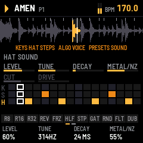

**EDIT** again from the kick: the snare, then the hat. **ALGORITHM** turns between its SOUND and SHAPE knobs,
**PRESETS** picks a built-in sound. Their steps: SEQ's SNARE and HAT lanes.

| Voice | Is | Presets |
| --- | --- | --- |
| SNARE | Two tuned sines with a pitch drop (the body) and band-passed noise (the snares), with a crack on the hit | 909 · TIGHT · FAT · GABBER |
| HAT | Six square waves at the 808's ratios and noise, through two high-passes | CLOSED · 808 · OPEN · TRASH |

| Knobs | K1 | K2 | K3 | K4 |
| --- | --- | --- | --- | --- |
| SOUND | Level | Tune | Decay | Tone (the hat: METAL / NOISE) |
| SHAPE | Snap (the hat: CUT, the high-pass) | Drive | | |

MIDI notes 38 (D2) play the snare, 42, 44 and 46 the hat, also while stopped. SAVE keeps the drums with the rest.
(ENV, which used to open SNARE / HAT, is tap tempo now: §3.)

## 9. The mixer

**LFO** opens the MIXER: four channels side by side, each a fader with a level meter (FX shows the chain's four
slots, lit: on). **LFO again** turns to GROOVE.

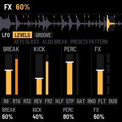

| Half | K1 | K2 | K3 | K4 |
| --- | --- | --- | --- | --- |
| LEVELS | BREAK: the break's level (its throws into the delay and the reverb too) | KICK: the kick's level (the KICK page's VOLUME) | PERC: the snare and the hat together | FX: the master FX chain against the dry sound |
| GROOVE | SWING (50–75 %) | DRUMS: through the FX chain or around it | | |

FX is how much of the chain you hear (the drums routed around it stay dry). Bring BREAK down to drop the break and
let the drums run alone, then up again for the drop. HOME keeps the gate, FX and COMPLEXITY to ride (K1, K3, K4) and the **DJ filter** (K2), which filters the
break alone: sweep it down and the drums stay full on top. The FLT pad throws it the same way.

## 10. Pages and knobs

| Page | K1 | K2 | K3 | K4 |
| --- | --- | --- | --- | --- |
| HOME (perform) | Gate | DJ filter on the break (left low-pass, right high-pass) | FX (the MIXER's) | Complexity (the GENERATOR's) |
| LFO (mixer) | Break level | Kick level | Snare and hat level | FX (the chain, dry to wet) |
| LFO again (groove) | Swing | Drums: through the chain or around it | | |
| HOME again (generator) | Complexity | Anchor | Roll | Fill |
| FX (the chain) | the focused slot's effect: its three settings (FX again: its MORE and MOD parts; an MB COMP its six, see §6) | | | Its mix |
| SEQ (patterns) | Slice | Pitch | Hits | Reverse |
| SEQ, a drum lane | Fill | Rotate | Clear / 4x4 | Copy |
| GLO (global) | Clock in | Clock out | Bluetooth | MIDI to |
| GLO again (pitch, snap) | Keep length / speed | Grain | Snap | Reset all (twice) |
| GLO a third time (BT audio) | On / off | Device | Scan | Connect / hang up |
| GLO a fourth time (channel) | MIDI channel (OMNI, 1–16) | Notes out | CC out | Program changes out |
| ARP (black keys hold effects; ARP again: MORE, MOD) | the shown key's effect: setting 1 | Setting 2 | Setting 3 | Mix |
| ENV (tap tempo; ENV again or a white key: a tap) | Tempo | Fine (0.1) | Half / double | Click level (0: off) |
| EDIT (kick; ALGORITHM its part) | see §8: MIX, SUB … CLICK FX, MACRO, OUT | | | |
| EDIT again (snare, then hat) | Level · Snap / cut | Tune · Drive | Decay | Tone |

**Gate** (HOME K1) cuts every slice the loop plays short: at 50 % each slice sounds for half its length, then
quiet until the next; down to 5 % for clipped, staccato chops; 100 % is off. It follows the tempo and the pitch, and
the slice lit in the waveform shrinks with it. It covers the loop's slices, ratchets and the RANDOM pad; key loops
(their LENGTH) and rolls keep their own; FREEZE holds the slice whole.

The generator rearranges the break as it plays: **complexity** is how often it jumps, **anchor** keeps the kick and
snare on the beats, **roll** repeats a slice or takes the one next to it, **fill** breaks the rules in the last bar
of a phrase; it is HOME's second part (HOME again). SEL + ARP writes a random pattern (ARP alone opens the black keys' effects).

## 11. The control map

Every page, button, encoder and key in one place. On the [site's manual](https://profikid.github.io/fm1-break-choppah/manual/#controls)
this section is interactive: pick a page and the screen, the seven encoders and the keys show what they do there;
below it, each button with its parts, the whole map as one table, and which of a held key, a held pad or the page
owns K1–K4. Here, in short: §2 has the rules, §10 every page's knobs.

## 12. Saving

SAVE keeps the tempo, pitch, swing, generator, the FX chain, the break chosen, each key's loop, the drums, the
mixer, the GLOBAL settings and all 16 patterns; SAVE is lit when something changed. A new version keeps what an older
one saved: new settings start at their defaults. (Version 0.32 changed the layout: what 0.31 and older saved starts
over at the defaults once; Bluetooth pairings stay.) GLOBAL's RESET ALL clears it all on purpose (§7).

## 13. Troubleshooting

- **No sound:** turn MASTER up; press PLAY.
- **A crash screen:** press a key to restart. Two failed starts in a row start safe mode, which the installer can
  still reach.
- **The install stops:** press Install again; it finishes a write that was cut off.
