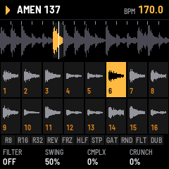
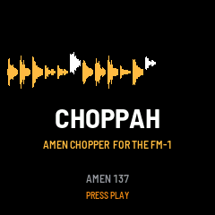
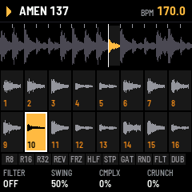
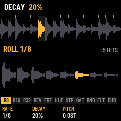
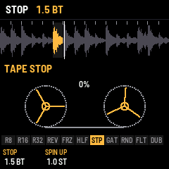
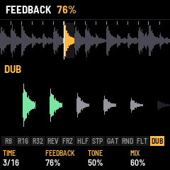
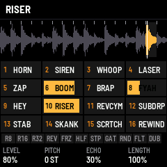

# CHOPPAH

CHOPPAH is an Amen chopper for the M-VAVE FM-1. A break is cut into sixteen slices, one on each white key, and
plays in time while you rearrange it, roll it, reverse it, stop it like a tape and push it through effects.

---

## Contents

1. Install
2. The screens
3. Playing
4. The pads
5. The soundboard
6. Pages and knobs
7. Saving
8. Troubleshooting

---

## 1. Install

**Try it first:** the emulator runs the same code in the browser, with sound, played with the mouse.

**Install:** open the install page in Chrome or Edge, connect the FM-1 by USB and press Install. If the FM-1 runs
M-VAVE's FM1 Open firmware, put M-VAVE's original firmware back first (M-VAVE's workbench, *Restore original*), then
install CHOPPAH.

## 2. The screens

At power-on CHOPPAH shows its mark, then the start screen: the loaded break drops in slice by slice. After two
seconds, or at once on any key, the **slicer view** opens. PLAY on the start screen also starts the break.

The slicer view, top to bottom:

- **Header:** play or stop, the break's name, the tempo.
- **The break:** its waveform, the slice markers, the slice sounding lit, the playhead.
- **Slice blocks:** sixteen blocks, one per white key, each with its slice's waveform. The slice sounding is lit;
  a key held is outlined.
- **Pads:** the eleven black-key pads, lit while held.
- **Knobs:** the page's four knobs and their values.

## 3. Playing

| Control | Does |
| --- | --- |
| PLAY | Play / stop. HOME + PLAY: back to bar 1 |
| White keys | Slices 1–16. Playing: at the next 16th. Stopped: at once. Held: that slice at every 16th |
| SELECT | Tempo, 1 BPM a detent (0.1 with SEL held). Tap SEL four times: tap tempo |
| OCT− / OCT+ | Pitch in semitones (hold to go faster). Both: back to 0 |
| ALGORITHM | The next or previous break: six built-in styles (SYNTH AMEN, SYNTH THINK, SYNTH APACHE, SYNTH FUNKY, JUNGLE ROLL, ONE DROP), then 13 recorded Amens (Cyberworm's loops: AMEN10 135 … VINYL, slowest first) |
| MASTER | Volume |

## 4. The pads

The black keys, left to right, act while held and combine. While a pad is held, the slice blocks give way to an
animation of what it does, and **K1–K4 tune that pad** (the foot shows its settings; SAVE keeps them):

| Pad | Does | K1 | K2 | K3 | K4 |
| --- | --- | --- | --- | --- | --- |
| R8 · R16 · R32 | Roll from the next 16th | Rate (1/4 … 1/64, triplets) | Decay | Pitch a repeat | |
| REV | Reverse | Speed | | | |
| FRZ | Freeze: the slice (or part of it) loops | Length (slice, 1/2, 1/4, 1/8) | Pitch | | |
| HLF | Half speed | Speed | | | |
| STP | Tape stop; let go and it spins back up | Stop time (beats) | Spin-up (16ths) | | |
| GAT | Gate | Rate (1/8, 1/16, 1/32) | Length | | |
| RND | Random slices | Amount | Random pitch | | |
| FLT | Throws the DJ filter | Target (LP … HP) | Resonance | Speed | |
| DUB | Sends the break into a tempo-synced dub delay; the echoes ring on | Time (1/8, 3/16, 1/4, 3/8) | Feedback | Tone | Mix |

 

## 5. The soundboard

**ENV** opens the soundboard: the white keys fire sixteen sound-system effects over the break, which keeps playing
(the black-key pads still work). Each tile burns down like a fuse while its sound plays.

| Key | Sound | Key | Sound |
| --- | --- | --- | --- |
| 1 | HORN: air horn, BAAP BAAP BAAAAP | 9 | HEY: a shout |
| 2 | SIREN: dub siren, wails while held | 10 | RISER: noise sweeping up while held |
| 3 | WHOOP | 11 | REVCYM: reverse cymbal |
| 4 | LASER | 12 | SUBDRP: sub drop |
| 5 | ZAP | 13 | STAB: horn stab |
| 6 | BOOM: gunshot | 14 | SKANK: the offbeat guitar chop |
| 7 | BRAP: five shots | 15 | SCRTCH: scratch |
| 8 | FYAH: a "FYAH!" shout | 16 | REWIND: the pull-up; the break spins back and drops in again from the top |

K1 level · K2 pitch · K3 **echo** (how much goes into the dub delay: sirens ringing out) · K4 length. All sixteen are
synthesised on the FM-1, so nothing is sampled. HOME goes back to the slicer.

## 6. Pages and knobs

| Page | K1 | K2 | K3 | K4 |
| --- | --- | --- | --- | --- |
| HOME (perform) | DJ filter (left low-pass, right high-pass) | Swing | Complexity | Crunch |
| ARP (generator) | Complexity | Anchor | Roll | Fill |
| FX | the focused effect's settings and mix (ALGORITHM picks the effect, FX again turns it on or off) | | | |

The generator rearranges the break as it plays: **complexity** is how often it jumps, **anchor** keeps the kick and
snare on the beats, **roll** repeats a slice or takes the one next to it, **fill** breaks the rules in the last bar
of a phrase. SEL + ARP writes a random pattern.

## 7. Saving

SAVE keeps the tempo, pitch, swing, generator, effects and the break chosen; SAVE is lit when something changed.

## 8. Troubleshooting

- **No sound:** turn MASTER up; press PLAY.
- **A crash screen:** press a key to restart. Two failed starts in a row start safe mode, which the installer can
  still reach.
- **The install stops:** press Install again; it finishes a write that was cut off.
