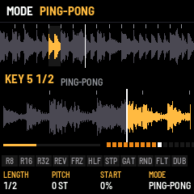
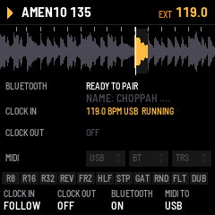

# CHOPPAH

CHOPPAH is an Amen chopper for the M-VAVE FM-1. A break is cut into sixteen slices, one on each white key, and
plays in time while you rearrange it, roll it, reverse it, stop it like a tape and push it through effects.

---

## Contents

1. Install
2. The screens
3. Playing
4. The pads
5. The soundboard
6. Pages and knobs
7. Saving
8. Troubleshooting

---

## 1. Install

**Try it first:** the emulator runs the same code in the browser, with sound, played with the mouse.

**Install:** open the install page in Chrome or Edge, connect the FM-1 by USB and press Install. If the FM-1 runs
M-VAVE's FM1 Open firmware, put M-VAVE's original firmware back first (M-VAVE's workbench, *Restore original*), then
install CHOPPAH.

## 2. The screens

At power-on CHOPPAH shows its mark, then the start screen: the loaded break drops in slice by slice. After two
seconds, or at once on any key, the **slicer view** opens. PLAY on the start screen also starts the break.

The slicer view, top to bottom:

- **Header:** play or stop, the break's name, the tempo.
- **The break:** its waveform, the slice markers, the slice sounding lit, the playhead.
- **Slice blocks:** sixteen blocks, one per white key, each with its slice's waveform. The slice sounding is lit;
  a key held is outlined; a dot marks a key with a loop of its own (§3, key loops).
- **Pads:** the eleven black-key pads, lit while held.
- **Knobs:** the page's four knobs and their values.

## 3. Playing

| Control | Does |
| --- | --- |
| PLAY | Play / stop. HOME + PLAY: back to bar 1 |
| White keys | Slices 1–16. Playing: at the next 16th. Stopped: at once. Held: the key loops (below), playing or stopped |
| SELECT | Tempo, 1 BPM a detent (0.1 with SEL held). Tap SEL four times: tap tempo |
| OCT− / OCT+ | Pitch in semitones (hold to go faster). Both: back to 0 |
| ALGORITHM | The next or previous break: AMEN (The Winstons), DRUMMER (James Brown, Funky Drummer), THE WORM (Jimmy McGriff), THINK (Lyn Collins), COLD SWEAT (James Brown), HOT PANTS (Bobby Byrd), APACHE (Incredible Bongo Band), SPORT (Lightnin' Rod): 2 bars each, played at the tempo you set |
| MASTER | Volume |

### Key loops

Hold a white key and it loops: a window that starts in its slice plays again and again in time, until you let go
(playing, the break carries on from there; stopped, it ends with the window). Held for a moment, the slice blocks
give way to **the key's view**: its window zoomed to the screen's width, the part this repeat has played lit (from
the right when it runs backwards), the playhead, the slice lines inside the window, this repeat's progress and a dot
for each repeat. A quick tap plays the slice once and keeps the blocks.

While the key is held, **K1–K4 set its loop**, for that key only (SAVE keeps them; a key with a loop of its own has a
dot on its block):

| Knob | Sets | Range |
| --- | --- | --- |
| K1 LENGTH | How long the window is, shown as music for this break | 1/8 of a slice … 16 slices (2-bar breaks: 1/64 … 2 BAR) |
| K2 PITCH | The key's own pitch, on top of OCT | −12 … +12 semitones |
| K3 START | Where in the slice the window starts | 0 … 94 % of the slice |
| K4 MODE | LOOP · PING-PONG (every other repeat backwards) · REVERSE · ONE SHOT (once, then quiet while held) | |

SEL while a key is held puts its loop back to one slice, no pitch, from the start, LOOP. With several keys held the
last one pressed loops; let it go and the lowest still held takes over. Pads still work on top: REV turns the loop
round, ROLL and FREEZE take it over while held.

## 4. The pads

The black keys, left to right, act while held and combine. While a pad is held, the slice blocks give way to an
animation of what it does, and **K1–K4 tune that pad** (the foot shows its settings; SAVE keeps them):

| Pad | Does | K1 | K2 | K3 | K4 |
| --- | --- | --- | --- | --- | --- |
| R8 · R16 · R32 | Roll from the next 16th | Rate (1/4 … 1/64, triplets) | Decay: DOWN (each repeat quieter) or UP (a swell up to full) | Pitch a repeat | Level of the repeats (5–100 %: low for ghost notes) |
| REV | Reverse | Speed | | | |
| FRZ | Freeze: the slice (or part of it) loops | Length (slice, 1/2, 1/4, 1/8) | Pitch | | |
| HLF | Half speed | Speed | | | |
| STP | Tape stop; let go and it spins back up | Stop time (beats) | Spin-up (16ths) | | |
| GAT | Gate | Rate (1/8, 1/16, 1/32) | Length | | |
| RND | Random slices | Amount | Random pitch | | |
| FLT | Throws the DJ filter | Target (LP … HP) | Resonance | Speed | |
| DUB | Sends the break into a tempo-synced dub delay; the echoes ring on | Time (1/8, 3/16, 1/4, 3/8) | Feedback | Tone | Mix |

 

## 5. The soundboard

**ENV** opens the soundboard: the white keys fire sixteen sound-system effects over the break, which keeps playing
(the black-key pads still work). Each tile burns down like a fuse while its sound plays.

| Key | Sound | Key | Sound |
| --- | --- | --- | --- |
| 1 | HORN: air horn, BAAP BAAP BAAAAP | 9 | HEY: a shout |
| 2 | SIREN: dub siren, wails while held | 10 | RISER: noise sweeping up while held |
| 3 | WHOOP | 11 | REVCYM: reverse cymbal |
| 4 | LASER | 12 | SUBDRP: sub drop |
| 5 | ZAP | 13 | STAB: horn stab |
| 6 | BOOM: gunshot | 14 | SKANK: the offbeat guitar chop |
| 7 | BRAP: five shots | 15 | SCRTCH: scratch |
| 8 | FYAH: a "FYAH!" shout | 16 | REWIND: the pull-up; the break spins back and drops in again from the top |

K1 level · K2 pitch · K3 **echo** (how much goes into the dub delay: sirens ringing out) · K4 length. All sixteen are
synthesised on the FM-1, so nothing is sampled. HOME goes back to the slicer.

## 6. GLOBAL: MIDI clock, Bluetooth, pitch

**GLO** opens the GLOBAL page: the slice blocks give way to the state of MIDI, and K1–K4 set it (SAVE keeps it).
**GLO again** turns to its second half, the pitch (below).

| Knob | Sets | |
| --- | --- | --- |
| K1 CLOCK IN | OFF · FOLLOW | Following, MIDI clock from USB, the TRS jack or Bluetooth sets the tempo (the header says EXT; SELECT and tap tempo wait), START plays from bar 1, STOP stops, and the loop eases onto the clock's beat every beat |
| K2 CLOCK OUT | OFF · ON | While playing, 24 clocks a beat (straight, whatever the swing); PLAY sends START, stopping sends STOP, HOME + PLAY sends START again |
| K3 BLUETOOTH | ON · OFF | Bluetooth MIDI: the FM-1 shows up as **CHOPPAH XXXX** in a computer's, phone's or tablet's Bluetooth MIDI settings. Off ends the link and stops advertising; at power-on it starts as saved |
| K4 MIDI TO | USB+BT · USB · BT | Where the clock goes |

The panel shows Bluetooth's state (ready to pair, connected), the clock coming in (its tempo, where from, running or
stopped), the clock going out, and a light for MIDI in and out on each port. The FM-1 has no MIDI out jack: MIDI goes
out over USB and Bluetooth only. On an iPhone or iPad, Bluetooth MIDI devices never show in Settings → Bluetooth:
connect from a MIDI app's Bluetooth MIDI page (GarageBand: a song's Settings → Advanced → Bluetooth MIDI Devices).

**The pitch (GLO twice):**

| Knob | Sets | |
| --- | --- | --- |
| K1 PITCH | KEEP LENGTH (the default) · SPEED | KEEP LENGTH changes the pitch only: each slice keeps its length (a granular pitch shift), so a key pitched +7 still fills its loop. SPEED is the classic repitch: up plays faster and shorter, down slower and longer (K1 left) |
| K2 GRAIN | 10 … 80 ms | KEEP LENGTH's grains: shorter keeps hits tight, longer sounds smoother on held sounds |

It covers every pitch in semitones: OCT, a key's pitch, the roll's pitch a repeat, the freeze's pitch, steps. The
tempo's own repitch, HALF, REVERSE's speed, the tape stop and the rewind stay speed effects.

## 7. Pages and knobs

| Page | K1 | K2 | K3 | K4 |
| --- | --- | --- | --- | --- |
| HOME (perform) | DJ filter (left low-pass, right high-pass) | Swing | Gate | Crunch |
| ARP (generator) | Complexity | Anchor | Roll | Fill |
| FX | the focused effect's settings and mix (ALGORITHM picks the effect, FX again turns it on or off) | | | |
| ENV (soundboard) | Level | Pitch | Echo | Length |
| GLO (global) | Clock in | Clock out | Bluetooth | MIDI to |
| GLO again (pitch) | Speed / keep length | Grain | | |

**Gate** (HOME K3) cuts every slice the loop plays short: at 50 % each slice sounds for half its length, then
quiet until the next; down to 5 % for clipped, staccato chops; 100 % is off. It follows the tempo and the pitch, and
the slice lit in the waveform shrinks with it. It covers the loop's slices, ratchets and the RANDOM pad; key loops
(their LENGTH) and rolls keep their own; FREEZE holds the slice whole.

The generator rearranges the break as it plays: **complexity** is how often it jumps, **anchor** keeps the kick and
snare on the beats, **roll** repeats a slice or takes the one next to it, **fill** breaks the rules in the last bar
of a phrase. SEL + ARP writes a random pattern.

## 8. Saving

SAVE keeps the tempo, pitch, swing, generator, effects, the break chosen, each key's loop and the GLOBAL settings;
SAVE is lit when something changed.

## 9. Troubleshooting

- **No sound:** turn MASTER up; press PLAY.
- **A crash screen:** press a key to restart. Two failed starts in a row start safe mode, which the installer can
  still reach.
- **The install stops:** press Install again; it finishes a write that was cut off.
